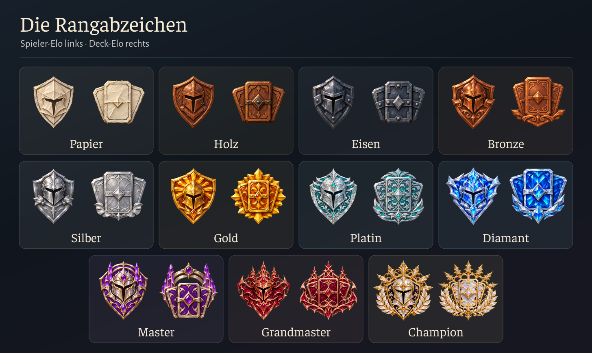
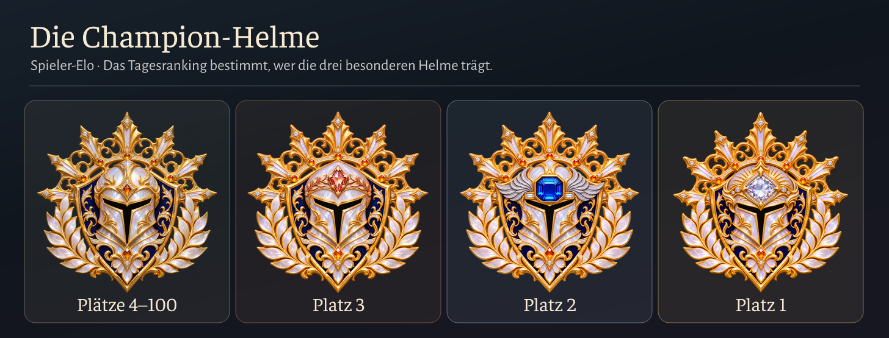

# Rangabzeichen

Links steht der Spielerhelm, rechts der Kartenfächer für das Deck. Ein Ligawechsel verändert Material und Silhouette. In einer Liga bleibt das Grundmotiv erhalten. Die Divisionsspange trägt die römische Ziffer und gewinnt je Aufstieg auf beiden Seiten ein weiteres Blatt.






## Einzelbilder

Beide Reihen enthalten je elf Ligaabzeichen und 24 Divisionsabzeichen. Drei Sonderformen des Champion-Spielerhelms ergeben insgesamt 73 Einzelbilder, jeweils als transparentes PNG mit 384 × 384 Pixeln. Der Dateiname besteht aus dem deutschen Liganamen in Kleinbuchstaben und bei Divisionen aus der angehängten römischen Ziffer, etwa [Spieler Gold II](player/gold-ii.png) und [Deck Gold II](deck/gold-ii.png). Bei 48 Pixeln bleibt die Silhouette erkennbar, die Ziffer wird sehr klein. Für kompakte Ranglisten gehört der vollständige Rangname neben das Bild.

| Liga | Spieler | Deck | Divisionen in Aufstiegsreihenfolge |
| --- | --- | --- | --- |
| Papier | [Helm](player/papier.png) | [Karten](deck/papier.png) | – |
| Holz | [Helm](player/holz.png) | [Karten](deck/holz.png) | III · II · I |
| Eisen | [Helm](player/eisen.png) | [Karten](deck/eisen.png) | III · II · I |
| Bronze | [Helm](player/bronze.png) | [Karten](deck/bronze.png) | III · II · I |
| Silber | [Helm](player/silber.png) | [Karten](deck/silber.png) | III · II · I |
| Gold | [Helm](player/gold.png) | [Karten](deck/gold.png) | IV · III · II · I |
| Platin | [Helm](player/platin.png) | [Karten](deck/platin.png) | IV · III · II · I |
| Diamant | [Helm](player/diamant.png) | [Karten](deck/diamant.png) | IV · III · II · I |
| Master | [Helm](player/master.png) | [Karten](deck/master.png) | – |
| Grandmaster | [Helm](player/grandmaster.png) | [Karten](deck/grandmaster.png) | – |
| Champion | [Helm](player/champion.png) | [Karten](deck/champion.png) | – |

| Champion-Platz | Spielerhelm | Mittelstein und Fassung |
| --- | --- | --- |
| 3 | [Lorbeerhelm](player/champion-3.png) | Roséfarbener Diamant im Drachenschliff zwischen kupfernen Lorbeerblättern |
| 2 | [Flügelhelm](player/champion-2.png) | Breiter blauer Diamant im achteckigen Stufenschliff, zwei helle Baguettes und silberne Schläfenflügel |
| 1 | [Kronenhelm](player/champion-1.png) | Großer heller Brillant mit farbigem Feuer, Pavé-Kranz und gravierten Sonnenstrahlen im Golddiadem |

Die 28 spielbaren Rangstufen und die Vergabe der weltweit höchstens 100 Champion-Plätze beziehen sich im [PoC](../../../tools/league-lab/README.md) auf Spielerkonten. Deckversionen besitzen eigene Elo-Werte. Die Zuordnung dieser Werte zu Deckligen ist offen.

## Material und Bewegung

Der [Materialshader](finish.wgsl) legt Licht auf die gemalten Oberflächen. Auf dem Helm biegt sich ein Reflex über die Stirn. Die seitlichen Karten des Deckfächers fangen ihn in anderen Winkeln als die mittlere Karte. Außenkontur und Durchbrüche behalten ihre ursprüngliche Transparenz.

| Liga | Materialwirkung | Umlauf |
| --- | --- | --- |
| Papier | Warmes, mattes Streiflicht auf den Falzen | Ruhend |
| Holz | Ein schmaler Wachsfilm folgt der geschnitzten Maserung | Ruhend |
| Eisen | Ein breiter, gebrochener Reflex auf gebürstetem Eisen | 10 s |
| Bronze | Kupferfarbener Glanz wandert über erhabene Partien, Patina bleibt in den Vertiefungen | 9 s |
| Silber | Eine helle Linie zieht einen weicheren zweiten Reflex hinter sich her | 8 s |
| Gold | Ein breiter, honigfarbener Lichtzug trifft die gravierten Sonnenstrahlen | 8 s |
| Platin | Versetzte silberweiße und mintfarbene Kanten betonen das Email | 9 s |
| Diamant | Blaue und weißblaue Reflexe springen zeitversetzt zwischen Facetten über | 7 s |
| Master | Im Amethyst steigt ein violettes Leuchten auf, die Goldfassung fängt einen feinen Reflex | 10 s |
| Grandmaster | Zwei rubinrote Lichtbögen laufen durch den Stein, sein Roségold antwortet versetzt | 9 s |
| Champion | Auf hellem Perlmutt wandert ein Opalschimmer zwischen Rosé, Eisblau und Grün | 12 s |

Ein Divisionsaufstieg verstärkt den Reflex am Rand der Spange um einen kleinen Schritt. Die Mitte mit der römischen Zahl bleibt lesbar. Alle Divisionen einer Liga teilen deren Tempo. Die drei Champion-Spielerhelme behalten den gemeinsamen Opalschimmer. Bei Platz 3 folgt ein warmer Lichtstrich dem Rosédiamanten und den Blattspitzen. Bei Platz 2 fangen die Stufen des blauen Diamanten, die Baguettes und die silbernen Flügel das Licht nacheinander auf. Bei Platz 1 bricht es sich farbig auf den Facetten des Brillanten und erreicht den Kranz kleiner Diamanten und die Goldgravur.

### Vorschau öffnen

Der Rust-Exporter übersetzt den WGSL-Shader mit Naga für WebGL 2 und bettet Shader und PNGs in eine lokale HTML-Datei ein. Der Export verwendet Deno 2 mit `deno bundle`. Die fertige Vorschau läuft offline im Browser. Man kann Liga, Bildreihe und Variante wechseln, das Original daneben betrachten und die Lichtphase von Hand einstellen. Bei reduzierter Bewegung startet die Ansicht mit ruhendem Licht. Ohne WebGL 2 zeigt sie die Originale.

```sh
mkdir -p target
cargo run --locked -- ladder > target/ladder.csv
cargo run --locked -p baylee-rank-art -- shaders target/ladder.csv target/rangabzeichen-shader.html
```

Die Vorschau nutzt eine RGBA8-Unorm-Textur und ein Unorm-Ausgabeziel mit sRGB-kodierten Farben und geradem Alpha. Der Shader rechnet das Licht in linearem RGB. Bei späterer Client-Anbindung mit sRGB-Hardwaredekodierung und -kodierung gehören die beiden Transferfunktionen an die jeweilige Pipelinegrenze. Die Phase ist ein normalisierter Umlauf von 0 bis 1. Der veröffentlichte Rang bestimmt Liga, Divisionsschritt und Podiumsplatz.

## Herkunft und Reproduktion

Die 22 Grundmotive wurden am 22. November 2026 mit ImageGen einzeln für Baylee gestaltet. Die Vorgaben waren ein freigestelltes Relief in Frontalansicht, Licht von links oben, ein geschlossener Helm auf einem spitzen Schild für Spieler und ein Fächer aus Kartenrücken mit Rautenschließe für Decks. Die Materialreihe reicht von Papier und Holz über Metall bis zu blauem Kristall, Amethyst, Rubin und gekröntem Opal. Eingaben waren ausschließlich Textbeschreibungen. Für die Beschriftung verwendet der Export die vorhandenen Schriften Faustina und Alegreya Sans aus dem Client. Ihre Lizenzen liegen [bei den Schriften](../../../crates/baylee-client/assets/fonts/licenses).

Für das Podium wurde der fertige Champion-Spielerhelm als Bildvorlage verwendet. Eine zweite ImageGen-Bearbeitung der drei vorhandenen Podiumshelme vergrößerte ihre Mittelsteine und gab ihnen unterschiedliche Schliffe, Fassungen und Verzierungen. Die 22 normalisierten Liga-PNGs und die drei fertigen Sonderhelme sind die Quellen für die 48 Divisionsbilder und drei Tafeln. Der Rust-Exporter liest die Divisionen aus der aktuellen Rangliste. Zur Reproduktion im Verzeichnis `tools/league-lab` ausführen.

```sh
mkdir -p target
cargo run --locked -- ladder > target/ladder.csv
cargo run --release --locked -p baylee-rank-art -- target/ladder.csv
cargo test --locked
```
