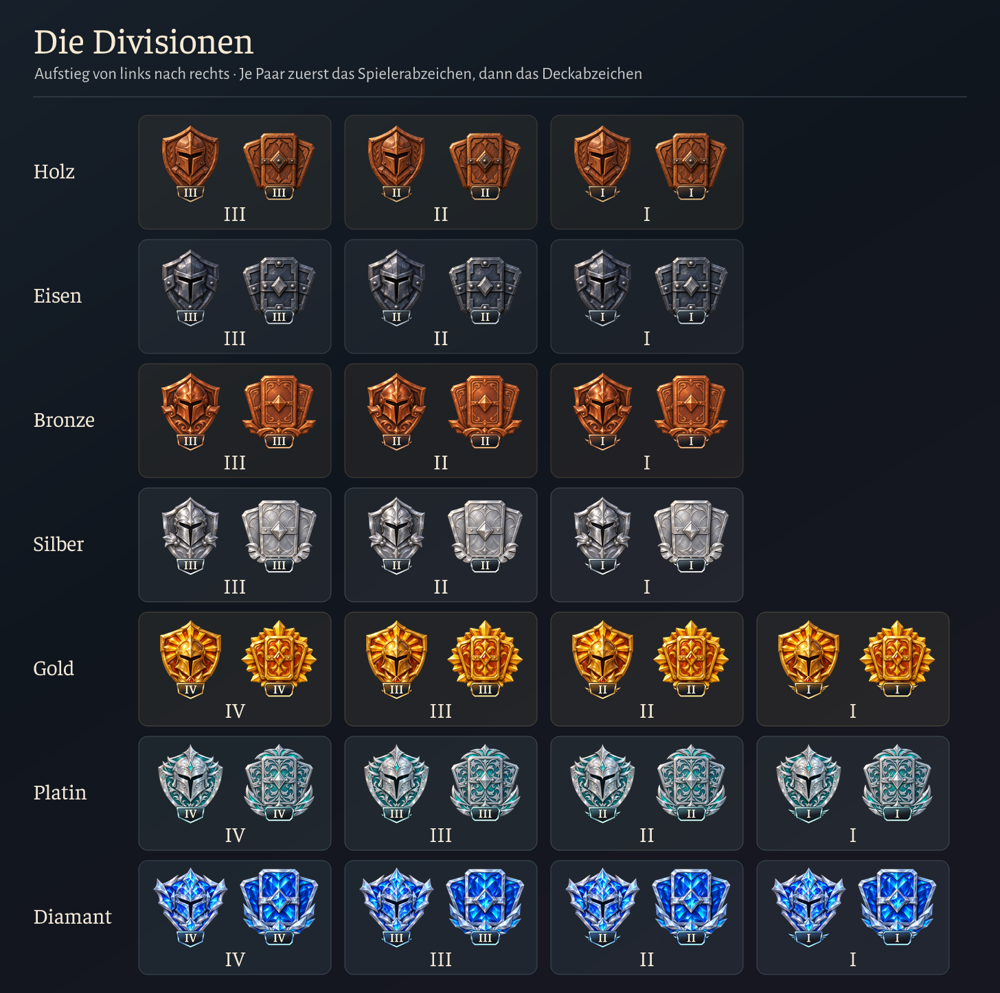

# Rangabzeichen

Links steht der Spielerhelm, rechts der Kartenfächer für das Deck. Ein Ligawechsel verändert Material und Silhouette. In einer Liga bleibt das Grundmotiv erhalten. Die Divisionsspange trägt die römische Ziffer und gewinnt je Aufstieg auf beiden Seiten ein weiteres Blatt.




## Einzelbilder

Beide Reihen enthalten je elf Ligaabzeichen und 24 Divisionsabzeichen. Drei Sonderformen des Champion-Spielerhelms ergeben insgesamt 73 Einzelbilder, jeweils als transparentes PNG mit 384 × 384 Pixeln. Der Dateiname besteht aus dem deutschen Liganamen in Kleinbuchstaben und bei Divisionen aus der angehängten römischen Ziffer, etwa [Spieler Gold II](player/gold-ii.png) und [Deck Gold II](deck/gold-ii.png). Bei 48 Pixeln bleibt die Silhouette erkennbar, die Ziffer wird sehr klein. Für kompakte Ranglisten gehört der vollständige Rangname neben das Bild.

| Liga | Spieler | Deck | Divisionen in Aufstiegsreihenfolge |
| --- | --- | --- | --- |
| Papier | [Helm](player/papier.png) | [Karten](deck/papier.png) | – |
| Holz | [Helm](player/holz.png) | [Karten](deck/holz.png) | III · II · I |
| Eisen | [Helm](player/eisen.png) | [Karten](deck/eisen.png) | III · II · I |
| Bronze | [Helm](player/bronze.png) | [Karten](deck/bronze.png) | III · II · I |
| Silber | [Helm](player/silber.png) | [Karten](deck/silber.png) | III · II · I |
| Gold | [Helm](player/gold.png) | [Karten](deck/gold.png) | IV · III · II · I |
| Platin | [Helm](player/platin.png) | [Karten](deck/platin.png) | IV · III · II · I |
| Diamant | [Helm](player/diamant.png) | [Karten](deck/diamant.png) | IV · III · II · I |
| Master | [Helm](player/master.png) | [Karten](deck/master.png) | – |
| Grandmaster | [Helm](player/grandmaster.png) | [Karten](deck/grandmaster.png) | – |
| Champion | [Helm](player/champion.png) | [Karten](deck/champion.png) | – |

| Champion-Platz | Spielerhelm |
| --- | --- |
| 3 | [Lorbeerhelm](player/champion-3.png) |
| 2 | [Flügelhelm](player/champion-2.png) |
| 1 | [Kronenhelm](player/champion-1.png) |

Die 28 spielbaren Rangstufen und die Vergabe der weltweit höchstens 100 Champion-Plätze beziehen sich im [PoC](../../../tools/league-lab/README.md) auf Spielerkonten. Deckversionen besitzen eigene Elo-Werte. Die Zuordnung dieser Werte zu Deckligen ist offen.

## Herkunft und Reproduktion

Die 22 Grundmotive wurden am 22. November 2026 mit ImageGen einzeln für Baylee gestaltet. Die Vorgaben waren ein freigestelltes Relief in Frontalansicht, Licht von links oben, ein geschlossener Helm auf einem spitzen Schild für Spieler und ein Fächer aus Kartenrücken mit Rautenschließe für Decks. Die Materialreihe reicht von Papier und Holz über Metall bis zu blauem Kristall, Amethyst, Rubin und gekröntem Opal. Eingaben waren ausschließlich Textbeschreibungen. Für die Beschriftung verwendet der Export die vorhandenen Schriften Faustina und Alegreya Sans aus dem Client. Ihre Lizenzen liegen [bei den Schriften](../../../crates/baylee-client/assets/fonts/licenses).

Für das Podium wurde der fertige Champion-Spielerhelm als Bildvorlage verwendet. Jede der drei Bearbeitungen verändert die Schmiedearbeit direkt am Helm. Die 22 normalisierten Liga-PNGs und die drei fertigen Sonderhelme sind die Quellen für die 48 Divisionsbilder und drei Tafeln. Der Rust-Exporter liest die Divisionen aus der aktuellen Rangliste. Zur Reproduktion im Verzeichnis `tools/league-lab` ausführen.

```sh
mkdir -p target
cargo run --locked -- ladder > target/ladder.csv
cargo run --release --locked -p baylee-rank-art -- target/ladder.csv
cargo test --locked
```
