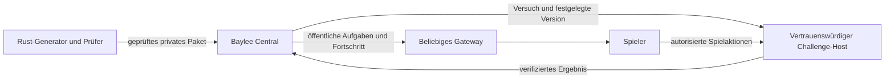

# Daily und Weekly für die erste Open Beta

Stand: 13.11.2026. Entwurf für `0.2.0-beta.o1`, keine Beschreibung eines
bereits verfügbaren Modus. Die ersten Experimente stehen im
[Versuchsbericht](../history/2026-11-13-challenge-feasibility.md).

## Das Spielerlebnis

Alle Spieler erhalten dieselbe Daily und dieselbe Weekly, unabhängig vom
Gateway. Baylee Central veröffentlicht die Aufgaben und verwaltet Versuche,
Ergebnisse, Ranglisten und dauerhaften Fortschritt. Der Spieler spielt selbst
mit einem gestellten Deck gegen einen festgelegten Gegner. Die eigene Sammlung
und gekaufte Vorteile spielen keine Rolle. Tower und Deckverbesserungen zwischen
Etappen bleiben ein eigenes, späteres Vorhaben.

Die erste Schleife lautet: **Aufgabe entdecken → Sieg schaffen → eigenes Ergebnis
verbessern → sichtbaren dauerhaften Fortschritt erhalten.** Ein Sieg soll sich
bereits lohnen, auch ohne Ranglistenplatz. Optimieren ist ein zusätzliches Ziel.
Daily und Weekly verwenden denselben technischen Ablauf; die Weekly verlangt
mehr Planung und mehr zusammenhängende Entscheidungen.

| | Daily | Weekly |
| --- | --- | --- |
| Rhythmus | täglich 00:00 UTC | montags 00:00 UTC |
| Erste Spielzeit-Hypothese | 15–25 Minuten | 45–90 Minuten, aufteilbar |
| Anspruch | ein klar erkennbares taktisches Thema | mehrere ineinandergreifende Entscheidungen |
| Einstieg | verständliches Deck, kurze Aufgabenbeschreibung | stärkere Synergien und mehr langfristige Abwägungen |
| Pause | Hauptwertung bleibt möglich | ausdrücklich vorgesehen |
| Wiederholung | unbegrenzt während des Fensters | unbegrenzt während des Fensters |

Diese Zeiten sind Testziele, keine Zusage des Generators. Falls normale Duelle
zu lang oder zu unberechenbar sind, folgt eine separat geprüfte Vorlage mit
vorgegebener Spielsituation. Eine Weekly wird nicht durch mehr Lebenspunkte
oder bloß längere Wartezeiten interessant.

Die Startkarte zeigt Thema, Schwierigkeitsbereich, verbleibende Zeit, gestelltes
Deck, nächstes eigenes Abzeichen-Ziel und die Regeln der Wertung. Ein kurzer
unverbindlicher Blick auf Beschreibung und Deck kostet keinen Versuch. Erst
„Versuch starten“ legt verbindlich einen Versuch an und gibt die Starthand frei.
Eine Übungsaufgabe mit anderem Setup erklärt den Ablauf, bevor jemand seinen
ersten gewerteten Versuch beginnt.

Nach dem Spiel stehen Sieg und Fortschritt zuerst, anschließend persönlicher
Bestwert und vergleichbare Ergebnisse. Bei Niederlagen gibt es eine konkrete,
spoilerarme Rückmeldung und einen klaren Weg zum nächsten Versuch. Eine
Feedback-Aktion erfasst „zu leicht“, „zu schwer“, „unklar“ oder „Regelfehler“.

## Wertung ohne widersprüchliche Anreize

Eine zusammengewürfelte Punktzahl aus Sekunden, Zügen und Fehlversuchen wäre
schwer verständlich. Die erste Version erhält getrennte Ansichten:

| Ansicht | Reihenfolge und Bedeutung |
| --- | --- |
| Erster Sieg | Fehlversuche vor dem ersten Sieg, danach dessen Spielzugzahl |
| Bester Sieg | kleinste Spielzugzahl eines eigenen Sieges; beliebig verbesserbar |
| Sprint, später | kleinste serverseitig gemessene Dauer eines ununterbrochenen Sieges |

Gleichstände teilen sich einen Rang. Es gibt keinen versteckten Vorteil für die
frühere Uhrzeit, schnelle Hardware oder einen kürzeren Namen. „Züge“ bezeichnet
die Spielzugnummer beim Sieg einschließlich gegnerischer Züge, nicht Mausklicks,
Prioritäts-Pässe oder Zahl der Protokollnachrichten. Die UI erklärt das.
Bonusziele und Abzeichen sind von der Ranglistenformel getrennt.

Aufgabe, Aufgabe aufgeben und eine regelkonforme Niederlage zählen als
Fehlversuch. Ein bloßer Verbindungsabbruch beendet keinen Versuch; ein erneuter
Login, Geräte- oder Gatewaywechsel setzt denselben Versuch fort. Währenddessen
spielt keine KI den menschlichen Sitz weiter. Für jede Aufgabe gibt es je
Account höchstens einen aktiven Versuch. Ein freiwilliger Neustart beendet
den vorherigen Versuch, bevor er eine neue Starthand liefert.

Ein nachgewiesener Serverfehler wird als technischer Abbruch separat verbucht
und zählt nicht als Niederlage. Wiederholte Verbindungsabbrüche allein sind
kein Beweis für einen Serverfehler. Bei einer global fehlerhaften Aufgabe wird
die Rangliste eingefroren und die Aufgabe zurückgezogen. Ehrlich erworbene
Teilnahme-/Abschlussfortschritte bleiben erhalten; betroffene Leistungswertungen
werden nachvollziehbar korrigiert. Ersatzaufgaben erhalten eine neue Identität.

Zum Ablaufzeitpunkt werden keine neuen gewerteten Versuche mehr angelegt.
Ein noch laufender Versuch kann im Archiv beendet werden und den einmaligen
Abschlussfortschritt geben, aber keinen nachträglichen Live-Ranglistenplatz.
Das Ablaufverhalten steht vor dem Start fest; bei der Weekly gibt es rechtzeitig
eine Erinnerung innerhalb der Oberfläche. Benachrichtigungen sind optional.

Sprint folgt erst, wenn die Zeitmessung über den vertrauenswürdigen Host
getestet ist. Die Uhr zählt Denkzeit und menschliche Netzwerkwege, zieht aber
gemessene Server-/Gegnerarbeit ab. Pausen und Verbindungsabbrüche schließen nur
diese Ansicht aus. Zeiten bleiben damit ein eigener Wettbewerb, keine heimliche
Nebenbedingung der zugänglicheren Hauptwertung.

## Dauerhafter Fortschritt

Abzeichen besitzen Bronze, Silber, Gold, Platin und Obsidian. Erreichte Stufen
gehen durch Spielpausen nicht verloren. Die folgenden Schwellen sind erste
Produktwerte; vor Veröffentlichung werden sie an erreichbarer Spielzeit geprüft.

| Abzeichen | Zählt | Stufen |
| --- | --- | --- |
| Tagesentdecker | unterschiedliche gewonnene Dailies | 1 / 10 / 30 / 100 / 365 |
| Wochenstratege | unterschiedliche gewonnene Weeklies | 1 / 4 / 12 / 26 / 52 |
| Taktiker | unterschiedliche Aufgaben unter ihrem vorab festgelegten Zugziel | 1 / 5 / 20 / 75 / 200 |
| Auf Anhieb | Live-Aufgaben im ersten Versuch ohne interne Lösungshilfen gewonnen | 1 / 5 / 20 / 75 / 200 |
| Stammgast | Wochen mit einer Weekly oder drei verschiedenen Dailies abgeschlossen | 1 / 4 / 12 / 26 / 52 |

„Stammgast“ zählt beliebige aktive Wochen, keine ununterbrochene Serie.
Archivabschlüsse zählen zu Tagesentdecker, Wochenstratege und gegebenenfalls
Taktiker, aber nicht zu Auf Anhieb oder rückwirkend zu einer aktiven Woche.
Mehrfaches Gewinnen derselben Aufgabe erhöht diese Zähler nicht.
Ein Aufgabenziel wird aus geprüften Lösungen konservativ abgeleitet und niemals
mit einem unbewiesenen mathematischen Optimum beworben.

Das Profil zeigt drei ausgewählte Abzeichen; die Aufgabenkarte zeigt beispielsweise
„Noch zwei verschiedene Dailies bis Silber“. Stufen können originale Rahmen,
Titel oder Profilakzente freischalten. Kein Abzeichen verbessert das Deck oder
gewährt einen Ranglistenvorteil. Ein Open-Beta-Erinnerungsabzeichen kann an wenige
Abschlüsse während der Beta gebunden sein, ohne tägliche Anwesenheit zu verlangen.

Interne Hilfen werden in drei Schritten angeboten: Hinweis zum Prinzip,
konkreterer Tipp, später Lösung. Ihre Nutzung wird vor der Ausgabe accountweit
für diese Aufgabe gespeichert, auch über Gateways hinweg. Unterstützte Siege
geben Abschlussfortschritt; für die unassistierte Wertung bleiben vorherige
Ergebnisse erhalten und spätere assistierte Versuche werden getrennt ausgewiesen.
Hilfe über Freunde, Streams oder andere Accounts ist nicht zuverlässig erkennbar;
„unassistiert“ bedeutet ausschließlich „ohne interne Lösungshilfe“.

Zusätzliche Vorschläge nach dem Kern:

- Themenwochen mit abwechslungsreichen Mechaniken, ohne sieben fast gleiche Decks.
- Acht-Wochen-Sammelalben mit mehreren frei wählbaren Zielen. Verpasste Inhalte
  bleiben über das Archiv erreichbar; historische Wettbewerbsplätze bleiben historisch.
- Freundesranglisten und eine Ansicht der eigenen Umgebung im Ranking, sobald
  genügend Teilnehmer existieren. Keine leeren Ligen für eine kleine Beta.
- Spoilerfreie Ergebniskarten zum freiwilligen Teilen, mit Versuchen und Zügen.
- Kurze Lösungsbesprechungen nach Ende der Wertung: zwei Wege und deren Abwägungen.
- Gemeinsame Wochenziele anhand verschiedener erfolgreicher Accounts, nicht
  anhand farmbarer Wiederholungen oder Online-Minuten.
- „Pfadfinder“ für mehrere echte Lösungswege erst nach validierter Klassifikation.

## Zuständigkeiten und Vertrauensgrenze

Central führt keine Magic-Regeln aus. Es verwaltet Aufgabenrevisionen, UTC-Fenster,
unveränderliche Account-IDs, Versuchszustände, die Ergebnisannahme, Ranglisten
und Fortschrittsereignisse. Ein Rust-Worker erzeugt und prüft Aufgaben vorab.
Ein von Central autorisierter Host führt die passende Engine aus. Gateways
vermitteln Zugang und zeigen dieselben Central-Daten; sie dürfen keine eigene
Daily erzeugen und keine Ranglistenwerte eigenmächtig festlegen.

Ein im Verzeichnis gelistetes Fremd-Gateway ist dadurch noch kein vertrauenswürdiger
Wettbewerbs-Host. Ein korrektes Replay beweist legale Spielaktionen, aber weder
ehrlich gemessene Zeit noch das Fehlen verschwiegener Fehlversuche. Für die Beta
werden gewertete Versuche deshalb nur auf kontrollierten Hosts ausgeführt.
Gateway-Tokens und Central-Anmeldung bleiben getrennt; ein eng befristetes
Startticket bindet Account, Aufgabe, Versuch, Host und Zweck. Das Central-Bearer-
Token wird nicht an fremde Gateways weitergereicht.

Eine atomare Startoperation legt den Versuch an, bevor private Information
sichtbar wird. Idempotenzschlüssel verhindern doppelte Versuche bei Wiederholung
eines Requests. Ein Abschluss ist nur für diesen gestarteten Versuch, diese
Paketrevision und den berechtigten Host zulässig. Ergebnis, Bestwert und einmaliger
Badge-Fortschritt werden transaktional verarbeitet. Ein erneuter Abschluss-
Request darf weder einen zweiten Sieg noch einen zweiten Fortschritt buchen.

## Eine Aufgabe ist mehr als ein Seed

Das unveränderliche private Paket enthält exakte Decklisten einschließlich
Druck-/Konstruktionsentscheidungen, Startzustand, Regeln, Spiel-Seed, unabhängigen
Gegner-Policy-Seed, Gegnerprofil, deterministische Arbeitsgrenzen, Engine-/Karten-/
KI-Version, Wertungsregeln, Zugziel und Lösungszertifikate. Sein Inhaltsdigest
bindet alle Bestandteile. Ein neuer Versuch hat eine eigene UUID v7, aber kein
neues Setup und keinen neuen Gegner-Policy-Seed.

Drei aktuelle Implementierungsdetails bestimmen die Ausführung:

1. `Session::describe` leitet die KI-Zufallsentscheidungen aus der Spiel-ID ab.
   Challenge-Identität und Versuchs-ID müssen getrennt werden. Das normale Spiel
   behält seine bisherige Ableitung; Challenge-Hosts benötigen eine explizite,
   aufgezeichnete Policy-Konfiguration.
2. Host-Slots und Wandzeitwächter können die Vorausschau auf einfachere Antworten
   zurückfallen lassen. Ein gewerteter Gegner darf dadurch nicht leichter werden.
   Für die erste Version eignet sich eine feste Policy ohne adaptive Vorausschau;
   anspruchsvollere Aufgaben folgen mit reservierter Kapazität und deterministischen
   Arbeitslimits. Ein technischer Wächter bricht ab, statt die Policy zu wechseln.
3. Die KI-Gleichstandsentscheidung verwendet außerdem `PlayerView.seq`.
   `Session::answer` erhöht diese Sequenz auch bei wirksamen Einstellungen ohne
   Spielaktion. Die Challenge-Policy benötigt deshalb einen stabilen Bezug auf
   Spielentscheidungen; zusätzliche UI-/Transport-Ereignisse dürfen ihre
   Zufallsentscheidungen nicht verändern. Das wird mit gleichen Spielaktionen
   plus verschiedenen Einstellungs-/Reconnect-Verläufen separat getestet.

Für Challenges dürfen der geheime Spiel-Seed, vollständige Zustände, zukünftige
Kartenreihenfolgen und Lösungszeugnisse nicht beim Client landen. Ein öffentlicher
Digest und die Aufgabenbeschreibung reichen zur Identifikation. Der vorhandene
`GameStatic.table_seed` ist bereits ein gekürzter kosmetischer Hash, nicht der
Spiel-Seed; aus diesem Feld folgt kein direkter Seed-Leak. Produktions-Seeds
dürfen trotzdem nicht aus einem kleinen erratbaren Datumsbereich stammen.
Seed-/Replay-Veröffentlichung ist erst nach dem Ende der Wertung möglich.
Bereits durch Spielen erlangtes Wissen und der Austausch zwischen Spielern
lassen sich dagegen nicht rückgängig machen.

Während eines Wertungsfensters bleiben Regeln unverändert. Updates aktivieren
neue Aufgaben mit einer neuen Revision. Sicherheitsrelevante Korrekturen dürfen
ein laufendes Paket zurückziehen. Das Archiv braucht eine getestete kompatible
Ausführung oder eine als solche bezeichnete Neuauflage; verwundbare Altversionen
bleiben nicht für historische Rekorde online.

## Automatische Erzeugung und Nachweis

Die Pipeline erzeugt Vorrat, nicht im Moment des Spieler-Logins:

1. Themen- und Schwierigkeitsschablone aus einem abwechslungsreichen Kalender wählen.
2. Mit dem bestehenden Synergie-Deckbau Kandidaten aus einem freigegebenen Kartenpool
   erzeugen. Exakte Größe, erlaubte Farben und Mechaniken anschließend hart prüfen.
3. Format, Deckbauentscheidungen und Karten prüfen. `Working` ist eine Vorauswahl
   anhand vorhandener Tests, kein Nachweis, dass diese Tests gerade bestanden haben.
4. Mehrere Spieler-Policies gegen dieselbe festgelegte Gegner-Policy laufen lassen;
   legale Entscheidungen und begrenzte Suche nur aus erlaubten Spieleransichten.
5. Siege erneut in frischen Sessions mit neu laufender Gegner-KI ausführen und
   zusätzlich exakte Replays prüfen. Abweisungen, KI-Notantworten, Abstürze,
   Zeit-/Aktionslimits führen zur Quarantäne dieses Kandidaten.
6. Lösungszeugnisse auf substanzielle Unterschiede prüfen; Qualität und Schwierigkeit
   bewerten, ähnliche kürzlich veröffentlichte Aufgaben aussortieren.
7. Privates Paket und Zertifikat einfrieren, dann in den Central-Kalender aufnehmen.

Der Veröffentlichungsmaßstab ist zunächst **mindestens drei geprüfte Siege aus
mindestens zwei nachvollziehbaren Lösungsfamilien**. Die Suche liefert positive
Zeugnisse. Wenn sie keine findet, ist die Aufgabe unbestätigt, nicht bewiesen unlösbar.

Ein Zeugnis enthält Spielerentscheidungen, gültige Informationsstände, Versionen,
Endzustand und deterministische Gegnerausführung. Reines Abspielen beider
aufgezeichneter Seiten prüft Legalität, aber nicht, ob der echte Gegner wieder
diese Antworten gewählt hätte. Deshalb sind beide Prüfungen nötig.

Die erste Klassifikation wird bewusst konservativ:

- Mana in anderer Reihenfolge tappen, andere Instanzen identischer Karten,
  zusätzliche Pässe und späteres Beenden derselben bereits gewonnenen Lage
  begründen keine weitere Familie.
- Unterschiedliche relevante Bedrohungen, Ressourcennutzung oder ein anderer
  Siegplan können eine Familie begründen. Unterschiede müssen aus dem tatsächlichen
  Verlauf hervorgehen; ein Deck-Tag wie „Ramp“ allein genügt nicht.
- Gegenbeispiele testen den Klassifikator: identischer Plan mit umsortierten
  Aktionen muss zusammenfallen, zwei bekannte unabhängige Pläne müssen getrennt
  bleiben. Uneindeutige Fälle bleiben unbestätigt und werden nicht veröffentlicht.

Für die erste Beta ist ein kleiner freigegebener Satz von Mechaniken und
Schablonen sinnvoll. Ihr spezifischer Prüfer kann wichtige Entscheidungen
erkennen, während ein allgemeiner Klassifikator für alle Magic-Strategien ein
zu großes Erstprojekt wäre. Anfangs werden Stichproben menschlich geprüft;
die tägliche Bereitstellung selbst läuft automatisch.

Ein Startziel für den Vorrat sind sieben Dailies, zwei Weeklies und separate
Ersatzaufgaben. Sinkt der Vorrat, warnt der Dienst. Fehlt eine geprüfte Aufgabe,
wird ein gekennzeichneter Klassiker ohne neue Live-Wertung angeboten. Ein
ungeprüfter Zufallskandidat darf nie automatisch nachrücken.

## Qualität, Messung und Umsetzung

Bot-Siegquoten helfen beim Sortieren. Sie ersetzen keine Messung mit Spielern.
Vor Veröffentlichung werden Testspieler nach Erfahrung getrennt beobachtet:
Zeit bis zum ersten verständlichen Spielzug, erster Sieg, Abbruchstelle, Zahl
der Versuche, subjektive Fairness und Lust auf eine weitere Aufgabe. Daily-
Kandidaten mit erzwungenem Einzelweg oder langen ereignisarmen Abschnitten
werden verworfen, selbst wenn ein Bot sie zuverlässig gewinnt.

Die Beta misst aggregiert Starts, Abschlüsse, Rückkehr am nächsten Tag und in
der nächsten Woche, freiwillige Wiederholungen nach einem Sieg, Hilfenutzung,
technische Abbrüche und Aufgabenbewertungen. Online-Minuten allein sind kein
Erfolgsmaß. Änderungen an Abzeichen oder Schwierigkeit werden anhand dieser
Werte geprüft; kleine Beta-Kohorten erlauben keine verlässlichen kausalen Aussagen.
Rohdaten, Replay-Aufbewahrung und Löschung werden vor Einführung in `privacy.md`
beschrieben. Öffentliche Ranglisten enthalten keine internen Account-IDs.

| Schritt | Konkretes Ergebnis | Abnahme |
| --- | --- | --- |
| Jetzt: Machbarkeit | Rust-Probe, Messbericht, festgehaltene Risiken | reproduzierbare Decks, echte Partien, genaue Aussage über gefundene Siege |
| 1: Zertifizierbares Paket | eingefrorene Policy, privater Seed, Kandidatenprüfer, enger Schablonensatz | frische Ausführung und Replay gleich; drei Siege/zwei Familien; Gegenbeispiele bestehen |
| 2: Central und Host | Aufgabenvertrag, atomare Versuche, autorisierter Abschluss | Gatewechsel, Doppelklick, Wiederholung, Manipulation, Neustart und parallele Requests getestet |
| 3: Daily im Client | Aufgabenkarte, Start/Fortsetzen, Ergebnis und zwei Ranglisten | reale Bedienung, alle Engine-Fragen, Unterbrechung und Wiederaufnahme getestet |
| 4: Weekly und Fortschritt | Weekly mit Pausen, fünf Abzeichen, Archiv | einmalige Vergabe, UTC-Grenzen, Hilfe, Ablauf und Versionierung getestet |
| 5: Vor Veröffentlichung | geprüfter Vorrat und kleine menschliche Testgruppe | Qualität, Laufzeit, Verständlichkeit und technische Fehler ausgewertet |

Vor der Einführung benötigen Central und Baylee abgestimmte Verträge. Weitere
Pflichttests: zukünftige Aufgaben nicht abrufbar; kein Seed/Hidden State in
Ansichten; manipulierte/revidierte Pakete abgewiesen; Zeitmessung nicht per
Clientuhr; veraltete/duplizierte Abschlüsse ohne Wirkung; fehlende Hostkapazität
ohne heimlichen Gegnerwechsel; ein Account kann einen Versuch nicht auf zwei
Gateways zugleich spielen; Entzug einer fehlerhaften Aufgabe ist idempotent.

### Quellen im Projekt und gestalterische Anregung

Technische Grundlage: [Deckbau](../../crates/cards/src/deckgen/mod.rs),
[Working-Pool](../../crates/baylee-train/src/working.rs),
[Haus-KI](../house-ai.md), [Protokoll](../protocol.md),
[Central-Anmeldung](../central-login.md), [Architektur](../architecture.md).
Die Trennung von Stufen und einmaligem Fortschritt ist ein eigener Vorschlag.
Anregung für sichtbare dauerhafte Stufen sind die offiziellen Beschreibungen
der [Ingress-Medaillen](https://support.ingress.com/hc/en-us/articles/41140360065947-Agent-Profile)
und [Pokémon-GO-Medaillen](https://scopelyexplore.helpshift.com/hc/en/5-pokemon-go/faq/1088-how-do-i-level-up-and-earn-medals/).
Daraus folgt kein gemessener Bindungseffekt für Baylee.
