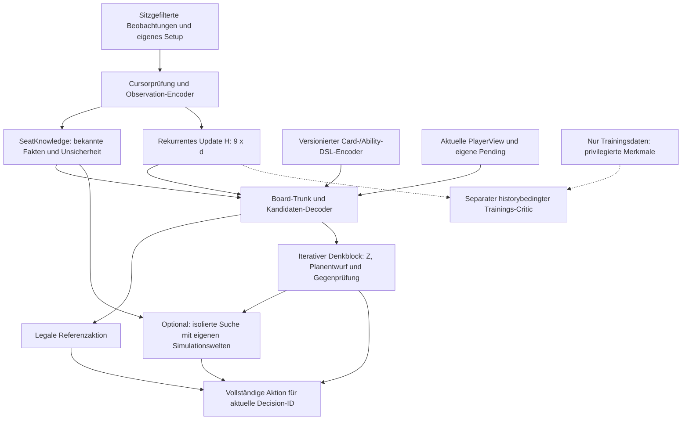

# Playernet v4 — kontinuierliche Beobachtung, strukturelle Kartenrepräsentation und sichere Suche

**Reviewstand:** 22. Oktober 2026; Codebasis `main` / `HEAD` @ `30779bc920147a2a2acc713ebcb784badceced4a`.

**Status am 24. Oktober 2026:** Die Implementierung ist bis `88bc2b07f` auf
`main`; die folgende Korrekturrunde liegt auf `c42/trained-ai`. Der
[aktuelle Ergebnis- und Korrekturbericht](../history/trained-ai-v4-review-2026-10-24.md)
und der [Implementierungs- und Trainingsbericht](../history/trained-ai-v4-codex-run-2026-10-22.md)
sind für tatsächlich implementierte Verträge, Korrekturen, Messungen und Grenzen
maßgeblich. Die ursprünglichen Reviewangaben unten beziehen sich auf die oben
genannte `main`-Basis, nicht auf den aktuellen Branch.

**Gemessene Modellwahl:** Der erste größere Trainingslauf verwendet `d=640`,
acht Schichten, zehn Heads und mit dem strukturellen Encoder rund **54,83 Millionen Parameter**. Der frühere
Trainingsbenchmark mit `B=8, U=32, K=1` benötigte etwa 3,3 GB VRAM;
der erste Vorlauf mit `K=1/2/4/8` erreichte etwa 5,2 GB. Die H-Schnittstelle
bleibt `9 × d`; Arbeitszustand Z und persistentes Gedächtnis H sind getrennt.
Der neue Karten-/Brettmix erreichte **8,33 GB allokierten Peak-VRAM**;
die früheren kleineren Messwerte sind keine Obergrenze.

**Vertiefung auf Wunsch des Besitzers (24. Oktober):** Der nächste Pilot
erhöht den räumlichen Trunk von acht auf zwölf Schichten bei unverändertem
`d=640`. Vier zusätzliche Residualblöcke beginnen als Identität; die
vorhandenen Gewichte und der Gedächtnisvertrag bleiben erhalten. Die größere
Variante muss Training auf 12 GB VRAM, ONNX-Parität und gepaarte Spiele
bestehen. Mehr Tiefe verlängert weder automatisch den zeitlichen Lernhorizont
U noch ersetzt sie Lernen aus eigenen Partien. Details und die anschließende
Rater-/Liga- und Haus-KI-Arbeit stehen im
[Tiefenpilot](../history/trained-ai-v4-depth-pilot-2026-10-24.md).

**Repräsentationsstand:** Der frühere 160-dimensionale DSL-Summary
verlor relevante Regelunterschiede (unter anderem Mana Leak/Negate).
Der [Repräsentationsaudit](../history/trained-ai-v4-codex-run-2026-10-22.md#representation-audit-next-architecture-priority)
führte zum bereits implementierten hierarchischen AST-Encoder mit expliziten
Identitäts-/Fähigkeitsbezügen (Encoder 6 / Modell 3). Die neue Gegenprobe
fand eine weitere Grenze: Laufzeitindizes zusammengesetzter Kopierfähigkeiten
sind keine gedruckten Indizes der primären kopierten Karte. Dafür wird die
öffentliche Provenienz jeder zusammengesetzten Fähigkeit einschließlich der
exakten zitierten `CopyMod::GrantAbility`-Definition projiziert. Der 54M-Versuch ist eine überprüfbare
Vergleichsbasis, nicht bereits die endgültige universelle Spiel-KI.

**Prüfmethode des ursprünglichen Reviews vom 22. Oktober:** Quellcodevergleich,
Bestandszählungen, CPU-Python-Proben und Primärquellen. Die damalige Aussage
„kein neuer Trainingslauf“ gilt nicht für die inzwischen verlinkten Messberichte.
Ein Benchmark auf `acenb` steht weiterhin aus.

Bezugsdokumente: [trained-ai](../trained-ai.md), [house-ai](../house-ai.md),
[Lookahead-Design](lookahead-design.md), [Architektur](../architecture.md),
[Protokoll](../protocol.md), [Trainer-Handover](../../tools/trainer/HANDOVER.md),
[historische Leistungsmessung](../../tools/trainer/perf-linux.md).

**Entscheidungsvorschlag:** Das gemeinsame Kartenfundament und eine dauerhaft
beobachtende Spiel-KI sind sinnvoll. v4 darf **von Grund auf und größer als v3**
trainiert werden; Architekturqualität und Spielstärke haben Vorrang vor einer
möglichst kleinen Parameterzahl. Zielprofil ist ein moderner dichter
rekurrenter Agent mit aktuell `d=640`, acht Layern, strukturellen Aktionsmerkmalen
und einem trainierten iterativen Denkblock mit eigenem Arbeitszustand.
Zuerst brauchen wir dafür korrekte Beobachtungs- und Aktionsdaten. Relationen und
fähigkeitsbezogene Aktionsmerkmale gehören in diese erste Version. Diff-Attention,
MoE, SPO, Muon und gelernte Suchdynamik sind einzeln zu prüfende Erweiterungen.
CPU-Inferenz ist der verbindliche Deploymentpfad; Phoenix-NPU-Inferenz ist ein
separates Experiment. Der bisherige Entwurf rechtfertigt weder 3–6 ms Latenz
noch seine VRAM-Schätzung.

## 0. Korrektur nach dem ersten Lauf auf dem erweiterten `main`

Der Lauf vom 24. Oktober trainierte **534.934 Frames aus 42 Spielen**,
darunter **74.418 Policyentscheidungen** (72.534 SingleChoice, 1.458 Subset,
339 Blocker, 87 Zahlen). Frames sind überwiegend Beobachtungen, keine gleich
große Zahl strategischer Lernbeispiele. Im identischen K=1-Vergleich gegen Sharp sank
die Duell-Siegzahl von **18/64 auf 15/64**, Commander von **3/32 auf 2/32**.
Duell-Paare: 3 Verbesserungen, 6 Verschlechterungen, 55 Gleichstände;
95-%-Table-Bootstrap für die Utility-Differenz etwa **−15,6 bis +4,7 Prozentpunkte**.
Commander hat nur acht unabhängige Tische und drei unaufgelöste Cap-Paare.
Das belegt keine Verbesserung, aber auch keine präzise geschätzte allgemeine
Verschlechterung. Der Kandidat wird nicht promoviert.

Ein zusätzlicher Kontrolllauf auf 52 weiteren Partien mit unverändertem Code
erreichte danach 23/64 Duellsiege, aber nur 1/32 Commander-Siege und dort mehr
Stalls/Fallbacks. Auch er wird nicht übernommen. Der positive Duellpunktwert
ist noch unsicher (Table-Bootstrap-95-%-Intervall der Differenz −3,1 bis
+17,2 Prozentpunkte). Formatbezogene Zuverlässigkeit bleibt eine eigene
Voraussetzung; eine aggregierte Siegzahl darf Commander-Probleme nicht verdecken.

Der Value-MSE fiel von 0,1530 auf 0,1176; die vorhandene Kennzahl
`val_active_top1_acc` fiel leicht von 59,28 % auf 59,03 %. Diese Kennzahl
bedeutet **Nicht-Pass-Labels** und lässt freiwilliges Passen bei vorhandenen
Alternativen weg. Der aktuelle Konverter schließt erzwungene Entscheidungen
bereits aus; alle 72.534 SingleChoice-Trainingszeilen hatten mindestens zwei
Kandidaten. Rund 90 % Gesamtgenauigkeit sind dennoch keine Zugpräzision eines
erfahrenen Spielers: Lehrerübereinstimmung und die vielen Pass-Labels ersetzen
weder Taktiktests noch Spielergebnisse.

Konkrete Konsequenzen für die nächste Stufe:

1. **Datenintegrität und Provenienz reparieren.** Zwei abgeschlossene Spiele
   scheiterten an Kopierfähigkeits-Referenzen. Sie bleiben bis erfolgreichem
   Neu-Replay in Quarantäne; kein Unknown-Embedding als stiller Ersatz.
   Bereits einzeln vollständig geprüfte Spiele können nach dokumentierter,
   konkret abgegrenzter Fehlerprüfung unabhängig genutzt werden. Ein bekannter
   Datenfehler darf keinen unabhängigen validen GPU-Job pauschal abbrechen.
2. **Loss defensiv absichern, Ursache korrekt benennen.** SingleChoice-Zeilen
   mit nur einer gültigen Option gehören nicht in den Nenner des Policy-Losses.
   Lossversion 2 schützt davor auch bei anderen/älteren Datenproduzenten.
   Der aktuelle Konverter emittiert solche Policyzeilen aber bereits nicht;
   ihr Ausschluss erklärt **keine Verbesserung dieses bisherigen Datensatzes**.
   Die zugehörigen Beobachtungen bleiben im Gedächtnis-/Value-Stream.
   Zusätzlich NLL, Top-1 und Anzahl für tatsächliche
   SingleChoice-Wahlfragen berichten; ein Pass mit Alternativen zählt mit.
   Subset-, Blocker- und Zahlenköpfe brauchen eigene Qualitätskennzahlen und
   sind in dieser Top-1-Zahl nicht enthalten.
3. **Policy-Auswahl und Value-Diagnose trennen.** Standardmäßig wählt der
   BC-Trainer nach Policy-Loss, nicht `Policy + 2×Value`. Der unveränderte
   Startcheckpoint kann mit `--validate-initial` mitbewertet werden. Das ist
   weiterhin nur Snapshotauswahl; die Freigabe braucht gepaarte Spiele und
   Taktiktests. `last.pt` behält den tatsächlichen Lernfortschritt separat.
   Im ersten Paket verbesserten sich beide Lossgrößen; das alte Kriterium ist
   daher ebenfalls keine nachgewiesene Ursache des schwachen Spielergebnisses.
4. **Breitere Erfahrungen vor mehr Parametern.** 10.058 Karten erfüllen das
   aktuelle Working-Kriterium, aber 42 Partien decken ihre Interaktionen nicht
   ab. Unverbrauchte, gesunde Partien verschiedener Tischformen zuerst nutzen;
   Entscheidungen, einzigartige Spiele und Mechanikabdeckung getrennt zählen.
   Eine Verdoppelung des 54,83M-Modells ist derzeit kein belegter Engpass-Fix.
5. **Eigene Fehlerzustände lernen.** Reine Haus-Imitation sieht die von der
   Haus-KI besuchten Zustände. Eigene Fehlzüge verschieben diese Verteilung.
   Als nächste eigenständige Etappe Lehrerlabels auf vom Schüler besuchten
   erlaubten Zuständen sammeln (DAgger-artig), mit vollständigem H-Verlauf,
   aufgezeichneter Verhalten-/Lehrerherkunft und getrennten Outcome-Labels.
   Keine fingierten Lehrer-Logprobs für PPO. Die Motivation folgt
   [Ross et al., AISTATS 2011](https://arxiv.org/abs/1011.0686); ein Gewinn für
   unser Mehrspielerproblem bleibt zu messen.
6. **Denkstufen behalten, Nutzen nachweisen.** K=1/2/4/8 bleiben trainier- und
   exportierbar. Dieselbe Lehrerantwort bei wechselndem K ist noch kein
   Revisionsziel. K=1 und K=4 zuerst auf denselben schwierigen Fällen prüfen;
   korrigierte und neu erzeugte Fehler zählen. Ein selbstsicherer Value und
   zusätzliche Schleifen sind kein Nachweis einer besseren Entscheidung.

Die H/Z-Trennung, der typisierte Encoder und die reine `PlayerView`-Grenze
bleiben sinnvoll. Exakte Ereignis-/Reconnect-Verträge, langes Gedächtnis,
DAgger/Szenarientraining und 15–45-s-Suche sind unterschiedliche Nachweise.
Der aktuelle Snapshot-Observer, ein trainierter Denkblock und viele
GPU-Stunden erfüllen sie nicht automatisch. Engineinterne Zwischenereignisse
ohne eigene autorisierte Beobachtung dürfen nicht als bereits vollständig
abgedeckt bezeichnet werden.

Auch `SeatKnowledge4` ist noch keine exakte Knowledge-Implementierung des
Entwurfs: `looking_at` enthält laut Protokoll auch Bibliothekskarten, wird aber
derzeit als Handherkunft gespeichert und entsprechend gezählt. Historisches
Sehen, aktueller gesicherter Ort und Unsicherheit müssen vor Suchrekonstruktion
getrennt werden; Sichtungsalter und Verlust des Trackingrechts brauchen eigene
Features/Tests. Dieses offene Featureproblem darf nicht durch Zugriff auf
verdeckten Enginezustand „repariert“ werden. Siehe den Ergebnisbericht.

## 1. Ziele und Grenzen

Experte 1 soll mit beliebigen unterstützten Karten und Decks, in Duellen,
Teams und Free-for-All mit bis zu acht Sitzen stark spielen. Das ist ein
Trainings- und Evaluationsziel, kein bereits durch einen Acht-Sitz-Tensor
erfüllter Vertrag. Varianten wie Emperor oder Archenemy erfordern zusätzlich
ihre tatsächlich implementierten Sonderregeln und eigene Tests. Sitzanzahl,
Teamaufteilung, Format und Variante werden getrennt erfasst.

**Primäres Qualitätsziel:** mindestens die Spielstärke und Zuverlässigkeit
eines guten erfahrenen Spielers im geprüften Format. Haus-KI-Siege,
Lehrerübereinstimmung und niedriger Value-Loss sind Zwischenmessungen,
keine Erfüllung dieses Ziels. Es braucht zurückgehaltene anspruchsvolle
Situationen, verlässliche Ausführung mehrschrittiger Linien und faire
Vergleiche mit erfahrenen Menschen (§7.7). Die Architektur soll dieses
Niveau ermöglichen; seine Erreichung lässt sich vor Training und Evaluation
nicht zusichern. Qualität hat Vorrang vor einem vorgegebenen Trainingsende.

Die Spiel-KI beobachtet während des gesamten Matches jeden für ihren Sitz
autorisierten Übergang. Sie hält Gedächtnis im RAM, verarbeitet gegnerische
Aktionen und kann im Hintergrund rechnen. Beobachtung wird niemals durch
einen `WakeFilter` ausgeschaltet. Ein Scheduler entscheidet lediglich, wann
die teure Policy oder Suche läuft. Ziel sind unter 50 ms für klare
Entscheidungen und 15–45 s Rechenzeit für schwierige Entscheidungen, mit einem
äußeren Abbruch spätestens bei 60 s beziehungsweise früher bei einer
laufenden Tischfrist. Diese Werte müssen auf dem Zielgerät gemessen werden.

Der Vergleich mit dem LLM-Seat braucht eine Präzisierung: `baylee-seat` nutzt
`WakeFilter`, aber [llm.rs](../../crates/baylee-seat/src/llm.rs) implementiert
bereits fortgeschriebene, begrenzte Gespräche, Notizen und gegebenenfalls
Provider-Sessions. „Liest jedes Mal das vollständige Matchlog neu“ beschreibt
den aktuellen Code nicht. Neu für v4 ist der explizite, bei jedem autorisierten
Übergang trainierte numerische Zustandsautomat.

Experte 2 übernimmt später dieselben Karten- und Fähigkeitsrepräsentationen
für Deckbau und Synergiebewertung. **Format-/Regelvalidierung bleibt
deterministischer Code**; ein Netz darf Vorschläge und verständliche
Begründungen liefern. Commander-Brackets sind fünf Kategorien einschließlich
Bracket 5 / cEDH, keine exakt aus einer Deckliste berechenbare universelle
Stärkeskala. Spielabsicht und Kontext gehören dazu; offizielle Kriterien und
Game-Changers-Daten werden separat versioniert. Siehe die offiziellen
[Bracket-Grundlagen](https://magic.wizards.com/en/news/announcements/introducing-commander-brackets-beta)
und das [Update vom 9. Februar 2026](https://magic.wizards.com/en/news/announcements/commander-brackets-beta-update-february-9-2026).

## 2. Hardware und belastbare Deploymentannahmen

| Einsatz | Vorgabe | Konsequenz |
| --- | --- | --- |
| Training lokal | Ryzen 9 3900X, 24 Threads, 64 GB RAM, RTX 4070 Ti mit 12 GB VRAM | CPU-Simulation und gebatchte GPU-Inferenz/Optimierung messen; BF16, kleine Sequenz-Microbatches und Gradient Accumulation. |
| Live auf `acenb` | Ryzen 7 PRO 7840U, 32 GB RAM, Ubuntu 26.04 vorgesehen | ONNX Runtime CPU als Referenz; FP32 zunächst, INT8/BF16 nur nach Operator-, Genauigkeits- und Latenzprüfung. AVX-512 BF16/VNNI allein garantiert keine beschleunigte Ausführung jedes Operators. |
| Radeon 780M | iGPU mit gemeinsamem Hauptspeicher | Optionaler Backendvergleich. Gerätedetektion oder `/dev/kfd` beweisen keine unterstützte ROCm/MIGraphX-Konfiguration für dieses Modell. |
| Phoenix XDNA 1 | NPU vorhanden laut Hardwarevorgabe | Kein zugesicherter v4-Linux-Backendpfad; eigener Machbarkeitstest, keine Voraussetzung zum Trainingsstart. |

**Korrektur der NPU-Annahme:** AMD Ryzen AI Software 1.8 beschreibt
Linux-Unterstützung für Consumer-APUs **ab Strix Point**, nicht Phoenix. Die
Modellmatrix führt PHX/HPT für CNN INT8, aber nicht für die aufgeführten
BF16-NLP-Pfade. Der Kernel dokumentiert zwar Phoenix-Hardware im
`amdxdna`-Treiber; daraus folgt kein funktionierender ONNX-Compiler/Execution
Provider für unseren Transformer unter Ubuntu 26.04. Das bedeutet fehlende
offizielle Abdeckung, nicht den Beweis technischer Unmöglichkeit.
Quellen: [AMD Linux](https://ryzenai.docs.amd.com/en/latest/linux.html),
[AMD Modellmatrix](https://ryzenai.docs.amd.com/en/latest/relnotes.html),
[Kernel-Treiber](https://docs.kernel.org/accel/amdxdna/amdnpu.html).

Für einen Backendversuch müssen Modellimport, quantisierte Operatoren,
Partitionierung/CPU-Fallbacks, Kopierkosten, dynamische Indizes und
Gedächtnis-I/O gemeinsam gemessen werden. Die
[AMD-Operatorliste](https://ryzenai.docs.amd.com/en/latest/ops_support.html)
ist abhängig von Datentyp und Backend; ein gültiger ONNX-Graph allein reicht
nicht. Messprotokolle nennen Softwareversionen, Threadzahl, Leistungsprofil,
Batchgröße, Tokenzahl, kalten/warmen Start sowie p50/p95/p99 einschließlich
Featurebau und Aktionsdekodierung. Historische OS-, Speicherplatz- oder
SSH-Angaben des ersten Entwurfs sind keine Messung dieses Reviews.

## 3. Geprüfter Iststand und Reparaturbedarf

### 3.1 Karten, Decks und Generatoren

- `data/decks/precon/STATUS.tsv`, nachgezählt am 24. Oktober: **53** Zeilen
  mit `playable == yes`. 40 enthalten laut `cards` mindestens 60 Karten,
  13 enthalten 26–40.
  Die TSV-Zahl allein belegt keine 60-Karten-Hauptdeckstruktur; Sideboards und
  Sonderzusammenstellungen müssen beim Import getrennt gelesen werden.
- `data/decks/eval/`: **15** Decks, darunter `white-weenie`, `red-burn`,
  `azorius-control`, `dimir-artifacts`, `sultai-graveyard` und die drei
  Commander-Decks `commander-padeem`, `commander-tatyova`, `commander-visara`.
  Die Dateinamen `01_white_weenie` bis `15_grixis_control` existieren hier nicht.
- Neun Hausdecklisten: `allytifact`, `victory`, `schwarzrand`, `weltenbaum`,
  `maik`, `kenrith`, `breya`, `tayam`, `kess`.
- Der aktuelle `Working::scan`-Report ergibt **10.693 registrierte Definitionen,
  10.058 mit `Coverage::Implemented`, 10.358 mit Testreferenz und 10.058 im
  Working-Schnitt**. Die alte Reviewbasis hatte 9.343/9.265; sie ist kein
  aktuelles Inventar mehr. Eine Testreferenz ist keine erneute Ausführung
  aller Kartentests. Der Trainingspool muss weiterhin durch
  [Working::scan](../../crates/baylee-train/src/working.rs) bestimmt werden:
  Implementierungsstatus **und** Testreferenz. „> 2.300“ ist als Untergrenze
  richtig, als aktuelles Inventar überholt.
- [deckgen.rs](../../crates/baylee-train/src/deckgen.rs) besitzt bereits einen
  intelligenten Generator: Constructed/Highlander/Commander, Farben,
  Archetypen, Kurven und Formatprüfung. Diesen erweitern und vermessen;
  keinen zweiten Generator von null planen.
- [league.rs](../../crates/baylee-train/src/bin/league.rs) startet standardmäßig
  mit **`allytifact,victory`**, nicht fünf Hausdecks. Ein `--decks house`-Alias
  existiert dort nicht. Generierte Decks sind über `--generated` möglich,
  standardmäßig ausgeschaltet; `rl_loop.sh` setzt entsprechend `GEN=0`.
  Precons werden nicht automatisch aus dem Verzeichnis eingelesen. Ihr
  Exportformat unterscheidet sich vom Hausdeckformat: vorhandene Deckreader
  nutzen, nicht nur weitere Namen an `HouseDeck::named` hängen.
- Arena unterstützt bereits `--decks eval`; `rl_loop.sh` nutzt dies.
  Die aktuelle Liga und Arena sind Duellpfade, obwohl `selfplay` bereits
  zwei bis acht Sitze und Teams unterstützt. Multiplayer-RL und dessen
  Evaluation benötigen daher eigene Arbeit.

Die 15 Eval-Decks bleiben vorerst eine getrennte Auswertungssuite. Werden sie
zum Training verwendet, muss vorher ein neuer gesperrter Testsplit entstehen.
Bekannte Karten in neuen Decks und vollständig zurückgehaltene
Karten/Mechanik-Kombinationen sind unterschiedliche Generalisierungstests.

### 3.2 Tatsächliche v3-Architektur

Quelle: [model3.py](../../tools/trainer/model3.py),
[features3.rs](../../crates/baylee-train/src/features3.rs),
[policy.rs](../../crates/baylee-train/src/policy.rs).

| Merkmal | Iststand |
| --- | --- |
| Standardnetz | `d=256`, vier Layer, acht Heads, FFN 1024, Kartenvektor 128 |
| Parameter bei `id_space=37_793` | **8.723.633** insgesamt; **4.837.504** im ID-Embedding; **3.159.040** im Transformer-Encoder, Rest Eingänge/Köpfe/Kartenfeatures |
| Embedding | Index-Lookup, aber `nn.Embedding` ohne `sparse=True`: Training hält dichte Gradienten/Optimizerzustände. Lookup-FLOPs sind kein vollständiges Speichermodell. |
| Sequenz | `[global, 8 seats, pooled deck, entities]`, also `T=E+10`; keine separaten `seen`-/`choices`-Tokens |
| Entitätsgrenzen | Rust maximal 256; Train/Export standardmäßig 192, also normalerweise höchstens 202 Trunk-Tokens |
| Policy | Zehn Familien: `FIXED`, `ENTITY`, `ABILITY`, `PAIR`, `ATTACK_PLAYER`, `PLAYER`, `COLOR`, `SUBTYPE`, `NUMBER`, `MODE`; 13 exportierte Logittabellen |
| Fähigkeiten | 57 Slots: 48 gedruckte, acht gewährte, ein Auffangslot; nicht acht insgesamt |
| Deck | Eigene Deckliste wird bereits gepoolt, mit `in_deck` und geschätztem `left` |

Die historische Angabe von etwa 4,2 GB für einen v3-Lauf aus `perf-linux.md`
ist kein Nachweis für den Speicherbedarf einer rekurrenten v4 mit acht Layern.

### 3.3 Gegenprüfung der sieben ursprünglichen Befunde

**Priorität P0** bedeutet: vor einem belastbaren neuen RL-Lauf beheben.
**P1** bedeutet: für das erklärte v4-Ziel erforderlich; zunächst ausdrücklich
begrenzte Abdeckung/Fallbacks möglich. Forschungsoptionen sind keine Bugs.

1. **Bitabschneidungen: bestätigt, Wirkung präzisieren — P0/P1.**
   [dataset.py](../../tools/trainer/dataset.py), `ENT_BITS`, entpackt
   `offered` mit fünf und `status` mit vier Bits. `PICKED=32` sowie
   `NO_ABILITIES=16`, `MELDED_CARD=32`, `TOKEN=64` gehen dort verloren.
   **Aber:** [dataset3.py](../../tools/trainer/dataset3.py) fügt ein eigenes
   numerisches `picked` hinzu. v3 ist damit nicht vollständig blind für
   bereits gewählte Objekte. Es fehlen insbesondere Zuordnungen der
   Teildeklaration und gewählte Spieler. Statusbits vollständig übertragen;
   Mehrfachauswahl zusätzlich als expliziten Decoderzustand modellieren.

2. **CastMode: größere semantische Lücke als ein Überlauf — P1.**
   `mode_kind` in `policy.rs` kann 22 Werte liefern, `model3.py` kennt nur 16.
   Die Funktion hat jedoch **keinen Aufrufer**: `opt(Choice::Mode(i))`
   schreibt `(H_MODE, i, 0)`. Heute erreicht jeder Modus den Kind-Slot null;
   ein tatsächlicher 16er-Kind-Überlauf erklärt das Verhalten somit nicht.
   Außerdem kollabieren Modusindizes ab 31 am 32er-Tabellenlimit.
   Kandidaten müssen Modusart, Face, Kosten und Bedeutung tragen; allein
   `N_MODE_KINDS=22` behebt das Problem nicht.

3. **Objektpointer zu Existenzbits reduziert: bestätigt — P1.**
   `dataset.py::expand_entities` verwendet bei `ENT_POINTERS` nur
   `(f >= 0)`. `attached_to`, `attacks_row`, `blocks_row`, `target_row`
   erreichen den Trunk ohne Zielidentität. Spielerziele sind separate
   relative Sitzfelder, keine Objektzeilen. Gerichtete Mehrfachrelationen
   und alle relevanten Ziele erhalten; §5.3 beschreibt das Format.

4. **Stack-/Kopiersemantik: bestätigt, ursprüngliche Verallgemeinerung falsch — P1.**
   `features.rs::public_id` sieht nur `o.card` und `o.token`.
   Eine gewöhnliche `StackItem::Ability` enthält dagegen ihren eigenen
   `source`, `ability`, `rules` und gegebenenfalls `token`-Deskriptor.
   Diese Bedeutung wird nicht als solche kodiert. Registrierte Token können
   bereits eine ID erhalten; nicht jede Token-Kopie ist `UNKNOWN_ID`.
   Umgekehrt erklärt eine bekannte physische Karten-ID keine kopierten
   Regeln. Physische Identität, aktive `RulesFace`, konkrete Fähigkeit und
   gewährte/kopierte Herkunft getrennt kodieren, auch nach Verlust der Quelle.

5. **Doppelte Transformation/strukturlose Hashes: bestätigt — P1.**
   `cardwalk.rs` transformiert die 512 Hashkanäle bereits mit signed-log;
   `model3.py::CardVectors` wendet `D.symlog(card_feats)` nochmals an.
   Das betrifft diesen Teil des insgesamt 706-dimensionalen Kartenfeatures,
   nicht zweimal alle Rohmerkmale. Die größere Grenze: Der Walker zerlegt
   die `Debug`-Darstellung, mischt AST-Pfade und Fähigkeiten in Hashzähler,
   verwirft u. a. Bool-/Stringwerte und Reihenfolge und begrenzt Zahlen.
   Er beschränkt sich **nicht auf acht Fähigkeiten**. Auch die einfachen
   Manapips verlieren Hybrid-/Phyrexian-/Schnee-Symbole; der Farbindikator
   wird nicht korrekt durch bloße Manakostenfarben ersetzt.
   Typisierten, versionierten DSL-Walker und Fähigkeitsembeddings einführen.

6. **Fehlende View-Felder: weitgehend bestätigt; Deck fehlt nicht — P1.**
   `features3.rs` bildet `owed`, `casting`, `targeting`, wirksame Face-/Rules-
   Identität, detaillierte Zahlungs-/Ziel-/Zahlenprompts und dynamische
   Fähigkeiten nicht ausreichend ab. Die Legalitätsmaske ersetzt ihre
   Bedeutung nicht. Eine eigene Deckrepräsentation existiert bereits:
   `Table.deck` → `deck_rows` → Pooling. Deren `left` ist eine aus bekannten
   Zonen abgeleitete **Schätzung**, kein exaktes Bibliotheksinventar;
   verdecktes Exil, Kopien und Identitätswechsel verhindern diese Gleichsetzung.
   Legale eigene Startliste separat bereitstellen und Wissen/Unsicherheit
   nachführen, niemals die wirkliche Bibliothek vom Host übernehmen.

7. **RL-Schleife: mehrere echte Fehler; andere Punkte sind Optionen — P0.**
   `convert3 --every 2` überspringt jede zweite *geeignete Entscheidung*
   nach dem Forced-Filter, spielweit gezählt. Es halbiert nicht sämtliche
   Ereignisse und nicht garantiert die Daten jedes Sitzes; alle Teilschritte
   einer behaltenen Entscheidung bleiben zusammen. GAE läuft dadurch auf
   gröberen Entscheidungsabständen; aktuell `gamma=1`, **`lambda=0.9`**.
   Schon `--every 1` erzeugt noch keinen vollständigen Beobachtungsstrom.
   `rl_loop.sh` reicht die Temperatur tatsächlich nicht weiter:
   Collector-Default **1.0**, `train_rl.py`-Default **0.7**. Der Fehler tritt
   also bereits mit den Defaults auf, nicht erst bei `TEMP != 1`.
   `omni_*` liegt in Spalten-Dateien (`.i32/.i16/.i64`), nicht einer `.bin`;
   enthalten sind andere Hände, Bibliotheks-Top-8 und Deck-/Restmultimengen,
   **kein vollständiger Enginezustand**. Der ungenutzte privilegierte Critic
   ist eine Option. Fehlende KL-/EMA-Verfahren sind kein belegter Grund
   früherer Instabilität und keine Pflichtreparatur.

### 3.4 Weitere im Code gefundene blinde Flecken

1. **Vier-Sitz-Relationen trotz acht Sitzen — P1.**
   `dataset.py::one_hot_rel(n=4)` klemmt `(x+1)` auf vier: relative Sitze
   **3 bis 7 kollabieren** bei Angriffs- und Spielerzielrelationen.
   Die Sitz-Tokens selbst haben acht Einträge. Alle relativen Sitzfelder
   zentral aus `MAX_SEATS` ableiten und ihre Nicht-Verwechslung prüfen.

2. **GAE verwendet das falsche Profil — P0.**
   `train_rl.py::advantages` ruft `train3.evaluate` auf. Dessen `run` setzt
   negative Profil-IDs auf **5**; `learner`/`self` sind solche IDs.
   `train_rl.forward` und der Live-Player nutzen dagegen **4 / expert**.
   Auch der Value hängt am Profilkontext. Baseline, Verhalten und Update
   müssen denselben verifizierten Kontext verwenden.

3. **Rekonstruierte alte Policy ist nicht zuverlässig die Collector-Policy — P0.**
   Der Collector speichert weder exakte Behavior-Logprobs noch eine
   per-Entscheidung-Herkunft `net/house/forced/search`. Fallbacks werden
   dem Learner zugerechnet. `min_behavior_p` filtert lediglich vermeintlich
   unmögliche Samples; es entfernt auch echte seltene Netzentscheidungen
   und lässt wahrscheinliche Hausentscheidungen durch. Zusätzlich faltet
   der Export ungesehene IDs auf das Unseen-Embedding, während der
   PyTorch-Referenzpfad die ID-Tabelle verwendet. Im trainierenden Netz ist
   ID-Dropout aktiv, im Collector/Referenznetz nicht. Dadurch kann schon
   vor einem Update `new_logprob != old_logprob` gelten.
   Behavior-Verteilung, Temperatur, Modell-/Schemahash, Kandidaten und
   tatsächliche Logprobs aufzeichnen; ID-Dropout zunächst nur im Pretraining.

4. **Mehrfachaktionen verlieren die Samplingreihenfolge — P0.**
   `policy::steps` rekonstruiert aus der fertigen Aktion eine kanonische
   Folge; sie muss nicht der im Collector gesampelten Reihenfolge
   entsprechen. Bedingte Wahrscheinlichkeiten hängen aber vom bisherigen
   Pick-Präfix ab. Das betrifft Ziele, Angreifer, Blocker und Zahlungen.
   Den echten Decodertrace speichern. Entweder jeden Pick als definierte
   Policy-Transition behandeln oder für die gemeinsame Aktion die Summe
   ihrer bedingten Logprobs verwenden; die beiden PPO-Ziele nicht vermischen.

5. **Draw-/Team-Value ist für Multiplayer inkonsistent — P0 vor Multiplayer-RL.**
   `dataset3.value_target` verteilt einen Draw auf die lebenden Sitze;
   `side_chance` summiert Teamanteile. GAE setzt Draw dagegen auf **0.5**.
   Beim Vierer-FFA stehen damit 0.25 und 0.5 für dasselbe Ergebnis;
   ungleich große Teams verschärfen das Problem. Eine gemeinsame
   Win/Draw/Loss-Utility je Seite definieren, z. B. 1/0.5/0. Mehrspieler-
   Werte sind keine durch Vorzeichenwechsel lösbaren Duellwerte.
   Gegner-zu-Gegner-Teamzugehörigkeit und vollständige Commander-Damage-
   Beziehungen benötigen mehr als `same_team` zur eigenen Seite und Maxima.

6. **Tokenlimits und Pile-Kompression verlieren Handlungsspielraum — P1.**
   `MAX_ENTITIES=256`, zusätzlich standardmäßig 192 in Train/Export;
   `MAX_DECK=128` begrenzt unterschiedliche Deckzeilen. Fehlende angebotene
   Objekte werden gemeldet, aber der Live-Pfad kann noch aus der verbleibenden
   Teilmenge wählen. Gleichartige Entitätspiles und deduplizierte Optionen
   verlieren individuelle Ziel-/Blockerzuordnungen. Ein Count-Feature
   allein repariert das nicht. Alle entscheidungsrelevanten Objekte
   individuell halten; Overflow vollständig und sichtbar behandeln.

7. **„Jede Karte“ scheitert auch an der Aktionsabdeckung — P1.**
   `policy.rs::options`/Supportprüfungen lehnen u. a. `ChooseManaAbility`,
   Schadensquellen/-effekte, Präventionsverteilung, Arrange, Kartennamen,
   Piles, bestimmte Zahlenfragen, gewährte Aktionen und einige Sondercasts
   ab. Die Number-Tabelle endet bei 63; Tabellen für Subtypen/Modi sind
   ebenfalls fest begrenzt. Nicht unterstützte Fälle absichtlich an die
   Haus-KI abzugeben ist korrekt, muss aber als Abdeckungsgrenze messbar
   sein. Schemaweite Coverage-Matrix, Grundcodes und dynamische Kandidaten
   ersetzen stilles Clamping. Kontrollierte fremde Entscheidungen brauchen
   explizite Sicht-/Controller-Semantik.

8. **Der Datensatz enthält Entscheidungsbilder, kein Zuschauen — P0 für Rekurrenz.**
   `convert3` kodiert nur die Sicht des gerade entscheidenden Sitzes.
   Andere Sitze, Forced-Aktionen und dazwischenliegende Übergänge bilden
   keinen zusammenhängenden Sitzstrom. `StateDelta`/Socket-Log-Tails sind
   dagegen bereits vorhanden, aber ihre Anzeigeprojektion filtert und
   fasst Ereignisse zusammen. Ein View-Diff allein rekonstruiert keine
   Karte, die zwischen zwei Snapshots kurz sichtbar war. §5.1 legt den
   gemeinsamen Beobachtungsvertrag für Training und Live-Betrieb fest.

9. **Lehrer und Zufallsquellen müssen zur Fairnessgrenze passen — P0.**
   `sharp`/`expert` können über `act_with_scouting` privilegierte Karten
   sehen. Normales Imitationstraining daher explizit ohne Scouting erzeugen;
   andernfalls lernt der Schüler widersprüchliche Ziele für gleiche Sichten.
   Die historische Warnung im Lookahead-Proposal zu `Session::new` ist
   inzwischen teilweise überholt: der Hauspfad nutzt `policy_seed(game, seat)`.
   Im Liga-Netzpfad bleiben aber `reseed(mix(seed ^ ...))` aus dem echten
   Spielseed und ein Loop-Guard auf `session.snapshot_hash()`.
   Unabhängigen Policyseed und einen Hash ausschließlich autorisierter
   Beobachtungen verwenden. XOR mit dem echten Seed trennt die Quellen nicht.

10. **Evaluation ist noch keine Promotion — P0 für automatische Liga.**
    `rl_loop.sh` setzt nach der Arena `prev=$model`, unabhängig vom Ergebnis.
    Eine akzeptierte Verbesserung, ein eingefrorener Vergleichsgegner und
    ein abgelehnter Kandidat brauchen getrennte Zustände. Außerdem fehlen
    Multiplayer-Arena, Konfidenzintervalle und eine Fallback-bereinigte
    Abdeckungsbilanz. Ein Checkpoint mit hoher Haus-Fallbackrate ist nicht
    allein wegen seiner Match-Winrate eine starke neuronale Policy.

11. **Exportvertrag ist schwächer als die Dokumentation — P1.**
    `netplay3::NetPlayer3::open` liest optionale Metadaten insbesondere für
    Buckets; es erzwingt nicht den vollständigen Encoder-/Featurevertrag.
    ONNX-Parität mit dem bereits gefalteten Exportmodell prüft außerdem
    nicht die Gleichheit zur vorherigen Collector-/Trainingspolicy.
    Versionen und Hashes für View, DSL, Kartenmanifest, Features, Aktionen,
    Rekurrenz und Modell obligatorisch validieren; unbekannte Verträge ablehnen.

12. **Fehleraufzeichnung existiert, überlebt aber nicht jeden Fehler — P0 für lange Läufe.**
    `league.rs` fängt unwindende Panics pro Spiel ab und rettet den Record
    aus einem äußeren `Session`-Slot. `bin/fuzz.rs` schreibt beim Panic
    dagegen ausdrücklich einen **leeren Record**. Die normale
    `Session::act`-/Pump-Aufzeichnung erfolgt zudem **nach** dem Engineaufruf:
    Die auslösende Aktion eines Panics kann im geretteten Präfix fehlen.
    `catch_unwind` schützt nicht gegen Abort, SIGSEGV, Prozess-OOM oder
    einen Engineaufruf, der nie zurückkehrt. Vorab persistierte Inputs,
    Prozessisolation und ein äußerer Supervisor sind die Ergänzungen in §7.5.

Die Prüfungen zeigen außerdem weitere noch nicht ausreichend kodierte
öffentliche Semantik: echte Subtypen und Counter-Arten, gewählte
Namen/Subtypen/Gegner, Battle-Protector, Commander-Tax, vorbereitete Sprüche,
offene Türen und gewährte Mana-/Cast-Berechtigungen. Eine Feldinventur muss
jedes relevante `PlayerView`-/`Pending`-Feld als exakt, bewusst abstrahiert
oder nicht unterstützt kennzeichnen. Uhren, fremde private Daten oder
bequeme Host-Interna gehören dadurch ausdrücklich nicht in den Actor.

### 3.5 Das frühere Bewertungsnetz: sinnvoll, aber kein allgemeiner Zugrichter

[ValueNet in model.py](../../tools/trainer/model.py) und
[train_value.py](../../tools/trainer/train_value.py) trainieren ein eigenes
Netz auf den späteren Sieger. Seine explizite Aussage lautet sinngemäß:
„Wie wahrscheinlich gewinnt der entscheidende Haus-KI-Sitz, wenn Haus-KIs
von dieser Stellung aus weiterspielen?“ Es erhält **keine zu bewertende
Alternativaktion**. Das ist ein Stellungswert `V`, kein aktionsabhängiger
Wert `Q` und kein direktes Urteil über die Güte eines Zugs.

Die beim Review tatsächlich gelesenen historischen JSON-Berichte unter
`/home/ace/baylee-data/models/` ergeben:

| Bericht | Beobachtung | Aussagegrenze |
| --- | --- | --- |
| `value-v1/report.json` | Brier 0,2084; Logloss 0,7225; ECE 0,1239 auf 214.978 Positionen. Logloss schlechter als konstante 50 % mit 0,6931. | Stark überkonfident; die höhere Gewinner-Trefferquote allein verschleiert das Problem. Die historische Dokumentation beschreibt Overfitting. |
| `value-v2/report.json` | Brier **0,1601** gegenüber 0,2090 der einfachen logistischen Baseline; Logloss 0,4770; ECE **0,0060** auf 400.000 ausgewerteten Positionen. | Deutlich brauchbarere Prognosen in diesem Datensatz, aber nur zwei Decks, ungefähr 200 unterschiedliche Karten und Haus-KI-Fortsetzungen. |
| `value-v2/eval-d004-mirror.json` | Auf 282.539 Mirror-Positionen Brier **0,1783** gegenüber 0,2492 der Sitz-/Zugphasenbaseline; ECE 0,0239. In Zügen 1–3 nur 0,2440 gegenüber 0,2500. | Signal über die bloße Deckidentität hinaus; frühe strategische Prognosen wesentlich schwächer als die Gesamtzahl vermuten lässt. |
| `v3-a/report.json` | Gemeinsames Policy-/Value-Netz: Brier 0,1574, ECE 0,0037 auf 288.995 Positionen. | v3 besitzt bereits einen eigenen trainierten Value-Head. Die aktuelle GAE-Schleife verwendet diesen, nicht das separate alte `value-v2`. |

Diese Zahlen wurden aus vorhandenen Berichten gelesen, **nicht neu unter
der aktuellen Engine gemessen**. Berichtsmengen unterscheiden sich; die
Tabelle ist kein neuer kontrollierter Architekturvergleich. Bei `value-v2`
werden Checkpoints anhand eines Ausschnitts derselben Held-out-Menge
gewählt, aus der auch der Abschlussbericht stammt: ein Validierungsresultat,
kein unangetasteter Abschlusstest. Viele Positionen eines Spiels sind
korreliert. Konfidenzintervalle deshalb über Spiele beziehungsweise gepaarte
Spiele bilden. Globale Kalibrierung genügt ebenfalls nicht: im v2-Bericht
liegt ECE für `expert` bei 0,0353 trotz des globalen Werts 0,0060.

**Zusätzlicher Befund im Legacy-Pfad, nicht im v3-Training:**
[train_policy.py](../../tools/trainer/train_policy.py) erzeugt `PolicyNet`
frisch und optimiert ausschließlich Policy-Cross-Entropy. Der ebenfalls
berechnete `value` erhält keinen Value-Loss. Trotzdem exportiert
[export_onnx.py](../../tools/trainer/export_onnx.py) diesen Kopf aus
`policy.pt`; es wird kein separat trainiertes `value-v2` hineinkopiert.
[netplay.rs](../../crates/baylee-train/src/netplay.rs) reicht dessen Sigmoid
als `Answer.value` heraus. Diese Zahl ist **nicht auf Gewinnziele trainiert**
und darf nicht als kalibrierte Bewertung behandelt werden. Die Aktionswahl
dieses Pfads verwendet Policylogits; damit ist kein Einfluss dieser Zahl
auf die gewählten Züge nachgewiesen. Für v4 Value-Herkunft und Loss-/Export-
Coverage ausdrücklich testen, statt die Existenz eines Ausgabetensors mit
einem ausgebildeten Critic gleichzusetzen.

**Konsequenz:** Einen Critic behalten, aber frisch auf breiten, gesunden
Daten und später auf den tatsächlichen verbesserten Policies trainieren.
Ein eingefrorener Richter für zwei alte Hausdecks soll die neue Policy
nicht dauerhaft begrenzen. Ob ein separates Netz besser ist als ein
gemeinsamer Trunk mit eigenem Kopf, entscheidet eine Ablation; die
historischen Ergebnisse belegen keinen Vorteil vollständiger Trennung.

## 4. Forschung: belastbare Bausteine und offene Experimente

Recherche bis **22. Oktober 2026**, einschließlich neuer Arbeiten aus 2026.
Ein Ergebnis aus Sprachmodellen, kontinuierlicher Kontrolle oder einem
Duellspiel ist eine Hypothese für Baylee, kein Nachweis für Acht-Spieler-Magic.
Die Auswahl unten trennt Veröffentlichungen und frische Preprints.

### 4.1 Policy, Value und Optimierung

| Baustein / Primärquelle | Befund und Konsequenz für v4 |
| --- | --- |
| [HL-Gauss / Stop Regressing, ICML 2024](https://proceedings.mlr.press/v235/farebrother24a.html) | Klassifikationsbasierte skalare Value-Ziele verbesserten Lernen in den untersuchten Settings. Das belegt weder ein allgemeines Scheitern von MSE/BCE noch, dass v3 seinen bereits kategorialen Gewinner-Head ersetzen muss. HL-Gauss als Ablation für bootstrappende skalare Returns testen. |
| [SimBaV2, ICML 2025](https://arxiv.org/abs/2502.15280) | Hypersphärische Normierung von Features **und Gewichten**, ergänzt um Value-/Skalierungsverfahren; nicht mit einem beliebigen Pre-RMSNorm-Residualblock gleichzusetzen. Übernahme einzelner Normierungen getrennt testen. |
| [SPO, ICML 2025, finale Paperfassung](https://proceedings.mlr.press/v267/xie25m.html) / [arXiv v9](https://arxiv.org/html/2401.16025v9) | Die quadratische Ratio-Penalty des ursprünglichen Entwurfs stimmt für diese Fassung. PPO verliert den Gradienten aber nur am jeweils vorteilhaften Clipping-Ende, nicht überall außerhalb des Intervalls. Erst korrekte PPO-Daten, danach ein direkter SPO-Vergleich. |
| [Reevaluating Policy Gradient Methods for Imperfect-Information Games, ICLR 2026 / Revision Mai 2026](https://arxiv.org/abs/2502.08938) | Breiter empirischer Vergleich unterstützt einfache Policy-Gradient-Baselines in untersuchten Spielen. Das spricht für eine ernsthafte PPO/PPG-Referenz, nicht für garantierte Gleichgewichte in Commander. |
| [Asymmetric Actor-Critic for POMDPs](https://arxiv.org/abs/2105.11674) | Ein reiner State-Critic kann bei History-Policies problematisch sein. Privilegierten Critic auf **Actor-Historyzustand und privilegierte Trainingsmerkmale** konditionieren. Geringere Varianz ist zu messen, nicht vorauszusetzen. |
| [DeepNash / R-NaD](https://arxiv.org/abs/2206.15378) | Erfolgreicher eigener Algorithmus für Stratego; „PPO/SPO + KL-Anker + Replay“ ist nicht R-NaD. Keine automatische Übertragung seiner Aussagen auf Mehrspieler-/Teamspiele. Vorläufig aus dem Pflichtpfad entfernen. |
| [Muon, offizielle PyTorch-Dokumentation](https://docs.pytorch.org/docs/stable/generated/torch.optim.Muon.html) | Für geeignete zweidimensionale **Hidden-Weights**; Embeddings, Ausgabeköpfe und Vektoren separat z. B. mit AdamW. Einsparung eines Second-Moment-Zustands ist möglich, Newton-Schulz benötigt aber Rechenzeit und temporären Speicher. Kein belegter Faktor 1,5–2 für Baylees Sample-Effizienz. |
| [When Does Muon Help Agentic RL?, Juli / Revision August 2026](https://arxiv.org/abs/2607.16169) | Neue, begrenzte Agenten-RL-Evidenz; stark abhängig von Lernrate und effektiver Updateskalierung. Nach passenden AdamW-/Skalierungskontrollen schrumpft der Vorteil. Kein Ersatz für mehrere Seeds und gleiche Wallclock-Budgets in unserer Ablation. |
| [Long-Horizon RL Needs Muon, 14. Oktober 2026](https://arxiv.org/abs/2610.20256) | Frischer Work-in-progress-Preprint mit kombinierter Optimierungs-/Trainingsrezeptur. Interessantes Experiment, aber der Titel isoliert keinen universellen Muon-Effekt. |

Für SPO ist das zu maximierende Sampleziel in der genannten Fassung

\[
r_t\hat A_t-\frac{|\hat A_t|}{2\epsilon}(r_t-1)^2.
\]

Auch diese Penalty braucht korrekte Behavior-Wahrscheinlichkeiten und
numerische Schutzmaßnahmen bei großen Ratios. Sie repariert keine Fallback-
Labels oder verlorene Decoderpräfixe. EMA liefert geglättete, **nicht
rauschfreie** Gewichte; einen EMA-Kandidaten separat exportieren, sammeln und
evaluieren, statt sein Verhalten mit Logprobs des Rohmodells zu vermischen.

HL-Gauss mit beispielsweise 51 Bins benötigt klar definierte Return-Skala,
Binzentren, Normalisierung der Randziele und eine validierte Bandbreite.
Seine Verteilung über skalare Returns ist **nicht automatisch epistemische
Unsicherheit** und darf nicht allein den Suchbedarf steuern. Bei Teamspielen
die gemeinsame Seitenutility konsistent verwenden; acht unabhängige
Softmax-Verteilungen sind keine normalisierte gemeinsame Gewinnverteilung.

### 4.2 Attention, Relationen und Gedächtnis

| Baustein / Primärquelle | Entscheidung und Fallstrick |
| --- | --- |
| [Differential Transformer, Originalimplementierung](https://github.com/microsoft/unilm/tree/master/Diff-Transformer) | Differenz zweier Attentionverteilungen ist eine plausible Ablation. Zwei Maps, Normierung und Kernelauswahl können Speicher/Durchsatz verschlechtern. Head-Aufteilung und Parametervergleich müssen der konkreten Fassung entsprechen; kein belegter Ersatz für „deutlich tiefere“ Baylee-Netze. |
| [Differential Transformer V2, aktuelle Autorenimplementierung](https://github.com/microsoft/unilm/tree/master/Diff-Transformer/Diff-Transformer-V2) | 2026 verfügbarer Ansatz mit Standard-FlashAttention-Kompatibilität und geänderter Lambda-/Normierungsstruktur. Entfernt die V1-Head-Norm wegen beobachteter Instabilität. V1 und V2 nicht zu einem ungetesteten Rezept vermischen; CUDA-Kernelvorteile übertragen sich nicht automatisch auf ONNX/NPU. |
| [Soft MoE, ICLR 2024](https://arxiv.org/abs/2308.00951) | Das Paper nutzt weich aggregierte **Expert-Slots** mit Dispatch/Combine. Ein globaler Gate-Mix aus fünf FFNs ist etwas anderes. Werden alle Experten je Token berechnet, sind auch alle aktiv. Paddingmasken, mögliche Informationsvermischung und Exportkosten beachten; zunächst dichtes FFN. |
| [Memory Retention Is Not Enough to Master Memory Tasks in RL, Januar 2026](https://arxiv.org/abs/2601.15086) | Gedächtnisqualität ist auch selektive Aktualisierung und Anpassung, nicht bloß langes Aufbewahren. Tests müssen widersprochene/veraltete Informationen und neue Strategien einschließen. |
| [Remember Less, Adapt Longer, 19. Oktober 2026](https://arxiv.org/abs/2610.25758) | Sehr frischer Preprint zu begrenztem rekurrentem Summary plus kurzem Kontext. Motiviert eine Buffer-Ablation; beweist weder neun Slots noch zuverlässige Erinnerung an beliebige Magic-Historien. |

Relationale Features sind zuerst eine **Behebung beobachteter Informationsverluste**,
kein Wettlauf um eine neue Attentionvariante. Standardattention mit
mehrfachen gerichteten Kanten genügt als Referenz. RMSNorm/QK-Norm und
SwiGLU sind plausible Optionen, verhindern aber nicht pauschal Entropiekollaps.
QK-Skalierung, Masken, numerische Stabilität und Exportparität prüfen.

### 4.3 Suche unter verborgener Information

- [Gumbel AlphaZero/MuZero, ICLR 2022](https://openreview.net/pdf?id=bERaNdoegnO):
  Kandidatensampling ohne Zurücklegen und Sequential Halving können knappe
  Suchbudgets sinnvoll verteilen. Der Nutzen hängt von Schätzqualität und
  Kandidatenabdeckung ab; das Verfahren löst weder Beliefs noch versteckte
  Information. Nicht jede Halving-Suche ist bereits MuZero.
- [ReBeL](https://arxiv.org/abs/2007.13544): zentrale Evidenz für die Verbindung
  von Suche und Lernen bei unvollständiger Information, mit theoretischem
  Rahmen für **Zwei-Spieler-Nullsummenspiele**. Diese Garantien gelten nicht
  unverändert für Acht-Spieler-FFA und wechselnde Bündnisse.
- [SkyNet: Belief-Aware Planning, März 2026](https://arxiv.org/abs/2603.27751):
  neue MuZero-bezogene Evidenz in einem teilweise beobachtbaren stochastischen
  Kartenspiel. Die Hilfsziele für beliefsensible Repräsentationen sind
  interessant, aber keine bewiesene explizite Belief-Rekonstruktion und
  kein Beleg für Magic mit dynamischen Objekten, Stack und Zielauswahlen.

**Folgerung aus der Recherche:** Ein sauberer Beobachtungs-/Aktionsvertrag
plus rekurrente PPO-Baseline hat für diesen Neustart höhere Priorität als
das gleichzeitige Einbauen sämtlicher Paperbausteine. Neue Arbeiten liefern
konkrete Ablationen, keine belastbare Komplettrezeptur für unsere Hardware.

### 4.4 Gelerntes Nachdenken und Überdenken einer Entscheidung

Die zusätzliche Anforderung ist **neuronales Planen**, nicht bloß das
Ausführen von handgeschriebenen Zugketten. Dafür ist Tiefenrekurrenz
innerhalb einer Entscheidung von History-Rekurrenz zwischen Ereignissen
zu unterscheiden. Die folgende Forschung ergänzt den ursprünglichen Entwurf:

| Primärquelle | Relevanz und Grenze |
| --- | --- |
| [Looped Actor, 29. September 2026](https://arxiv.org/abs/2609.37432) | Besonders passend: RL-Policy mit wiederholt angewendetem Transformerblock und adaptiver Rechentiefe, untersucht u. a. an Planungsaufgaben. Neue Preprint-Evidenz für gelerntes internes Planen; keine bereits erprobte Magic-/POMDP-Lösung. |
| [TRM / Less is More, Oktober 2025](https://arxiv.org/abs/2510.04871) | Iterative Verfeinerung eines latenten Lösungszustands bei Puzzleaufgaben motiviert einen kompakten Denkblock. Übertragung auf variable legale Aktionen, Zufall und Gegenspieler braucht eigenes Training. |
| [Elastic Latent Recurrence, 8. Oktober 2026](https://arxiv.org/abs/2610.12582) | Frischer LLM-Preprint: gemischte Rekursionstiefen, gated Updates und Budget-/Loopkontext erhalten dort den schnellen Ein-Pass-Pfad. Diese Trainingsideen sind für v4 prüfenswert; die gemessenen LLM-Gewinne nicht übertragbar. |
| [RecurTrace, Revision 19. Oktober 2026](https://arxiv.org/abs/2609.03379) | Vorherige Denkzustände und ein trainiertes Stoppsignal können helfen. Für v4 nur ein begrenzter Denkbuffer; Stabilität oder hohe Sicherheit einer Antwort allein beweisen keine Richtigkeit. |
| [Thinker, NeurIPS 2023](https://arxiv.org/abs/2307.14993) | Ein Agent kann lernen, ein Weltmodell zum Planen zu nutzen. Das motiviert später gelernte Auswahl von Sucharbeit; es setzt weiterhin brauchbare Modellergebnisse und unsere Sichtbarkeitsgrenze voraus. |

Die Architekturentscheidung in §5.6 ist unsere Ableitung daraus: ein
trainierter Denkblock mit schnellen und längeren Ausführungen gehört zum
Zielmodell. Ein vollständiges gelerntes Magic-Weltmodell ist dafür nicht
Voraussetzung. Seine Spielstärkewirkung wird separat geprüft.

## 5. Architektur der ersten implementierbaren v4

### 5.1 Ein Beobachtungsvertrag für Training und Live-Betrieb



Der neue Actor-Eingang besteht aus `PlayerView`, **seinem** `Pending`, einem
sitzautorisierten Setup und einem strukturierten Beobachtungsstrom. Das Setup
enthält eigene eingereichte Karten, öffentliche Teams/Format/Regeln und
unabhängigen Policyseed, niemals den vollständigen `GamePreset`.

Die bestehende Anzeige-Logprojektion ist ein Ausgangspunkt, kein vollständiger
Maschinenvertrag. Der Host projiziert zusätzlich die benötigten typisierten
Ereignisse nach derselben Sichtbarkeitsgrenze: sichtbare Objektwechsel,
öffentliche Aktionen, berechtigte Reveals, Mana-/Phasenänderungen und
Entscheidungsabschluss. Keine internen Journale durchreichen. Berechtigung
zum **Ereigniszeitpunkt** prüfen; spätere Sichtbarkeit darf frühere Geheimnisse
nicht nachträglich öffnen. Gegnerische private `Pending`-Optionen bleiben privat.

Ein vollständiger Snapshot und seine Ereignisse haben unterschiedliche
Cursor. Wiederholte Log-Tails und gleiche `view.seq` dürfen das Gedächtnis
nicht mehrfach fortschreiben. Lücken sind explizite Zustände; vor einer
Entscheidung muss der Beobachter deren Watermark verarbeitet haben. Ein
Reconnect lädt einen kompatiblen Gedächtnischeckpoint plus berechtigten Tail
oder startet sichtbar mit unvollständiger History. Nachträgliche Wiederholung
kann bei Recovery nötig sein; „niemals Replay“ wäre kein erfüllbarer Vertrag.

Vorgeschlagene, noch nicht vorhandene Schnittstellen:

```text
observe(batch, observation_cursor) -> updated_memory_and_knowledge
decide(view, own_pending, decision_id, memory, knowledge, work_budget) -> action
ponder(immutable_authorized_snapshot, independent_seed, fixed_work_plan) -> cache
reset_or_recover(model_schema, checkpoint, authorized_tail) -> observation_state
```

Training zeichnet dieselben projizierten Beobachtungen für **jeden Sitz** auf,
auch ohne dessen Entscheidung. `observe_mask`, `decision_mask`, Reset,
Terminal, Unterbrechung und Kontrollwechsel sind getrennte Felder. Eine
erzwungene Aktion darf keinen Policy-Loss benötigen und trotzdem wichtig
für das Gedächtnis sein. Gleichzeitige Mulliganfragen oder wiederholte
Anfragen sind keine mehrfachen Weltereignisse.

### 5.2 Neun Gedächtnisslots: sinnvoller Start, keine exakte Wissensbasis

`H ∈ R^(9 × 384)` benötigt **6,75 KiB in BF16** beziehungsweise 13,5 KiB in
FP32 je Sitzinstanz. Der reine Zustand ist klein; teuer ist sein
Trainingsgraph. Ein globaler Slot und acht relative Sitzslots sind eine
brauchbare induktive Struktur. Die Benennung allein erzwingt weder einen
„Plan“ noch kalibrierte Beliefs oder eine ausreichende Informationskapazität.
Zum ursprünglichen 512er-Vergleichsprofil passt `H ∈ R^(9 × 512)` mit nur
**9 KiB BF16**; der aktuelle 640er-Lauf verwendet **11,25 KiB BF16** je Sitz.
384 ist kein hartes Limit; Slotbreite und Slotanzahl werden anhand
der Gedächtnistests verglichen, nicht aus der alten Modellgröße abgeleitet.

Drei getrennte Speicher haben unterschiedliche Aufgaben:

| Speicher | Inhalt und Grenze |
| --- | --- |
| `SeatKnowledge` | Exakte **beobachtete** Fakten, eigene Startmultimenge, bekannte Karten mit Entitlement/Unsicherheit, öffentliche Historyfakten für Resume. Verdecktes Mischen oder nicht verfolgbarer Zonenwechsel entwertet Identitätswissen. Kein heimliches Tracking anhand interner IDs. |
| `H` | Gelernte Zusammenfassung: Strategie, Gegnerverhalten, probabilistische Hypothesen. Kann vergessen und darf keine alleinige Quelle beweispflichtiger Suchvoraussetzungen sein. |
| Kurzer Eventbuffer, optional 16–64 Einträge | Lokaler Kontext für komplizierte Ereignisfolgen; Ablation gegen reine Rekurrenz. Keine unbegrenzt anwachsende Transformer-History. |

Die relative Sitzordnung bleibt zur **eigenen kontrollierenden Perspektive**
stabil, nicht zum aktiven Spieler. Eliminierte/fehlende Sitze werden maskiert,
nicht umsortiert. Teamrelationen bleiben explizit. Private Hypothesen eines
Teamkollegen werden nicht allein wegen Teamzugehörigkeit übertragen.

Ein kleiner Eventencoder aktualisiert die Slots mit einer GRU-artigen Zelle,
beispielsweise `H'=(1-z)*H+z*candidate`. Das ist zunächst ein gated recurrent
Modul; die Bezeichnung „selektives State-Space-Modell“ verlangt eine tatsächliche
entsprechende Implementierung. Aufmerksamkeit auf aktuelle Kontexttokens kann
ergänzt werden. Der große Board-Trunk läuft an Entscheidungen und bei
wesentlichen Änderungen; **jedes** Ereignis erreicht den kleinen Beobachter.
Das ist konstant in der bisherigen Historylänge, nicht konstant unabhängig
von Brettgröße, Ereigniszahl oder Knowledge-Datenstruktur.

`decide` verändert das echte `H` nicht durch wiederholtes Auswerten derselben
Situation. Mehrfachpicks haben einen separaten Decoderzustand. Suchäste und
Pondering arbeiten mit Kopien; nur echte autorisierte Beobachtungen verändern
das reale Gedächtnis. Ein später verworfener hypothetischer Gegnerzug darf
nicht als echte Erinnerung zurückbleiben.

Training nutzt zusammenhängende `(game, seat)`-Streams mit TBPTT, z. B.
16/32 Lernschritten und experimentell 32/64 Burn-in-Schritten. Burn-in mit
aktuellen Gewichten, gespeicherte Actorzustände mit Modellversion und klare
Detach-Grenzen berücksichtigen; veraltete Hidden States sind sonst eine
weitere On-/Off-policy-Abweichung. Lange Erinnerung braucht Tests weit über
die Chunklänge hinaus. Ein Nullzustand für jeden zufälligen Frame trainiert
kein Matchgedächtnis.

Im aktuellen Lauf zählt `U=32` **Beobachtungen**, nicht 32 eigene strategische
Entscheidungen. Gerade an großen Tischen kann diese Gradientstrecke nur wenige
eigene Entscheidungen umfassen. H bleibt vorwärts über die ganze Partie erhalten,
aber das allein lernt keine beliebig weit zurückreichende Kreditzuweisung.
Als eigene Ablation nach dem Integritätslauf U=64/128 mit kleinerem B und
gleicher Zahl echter Policypositionen sowie Burn-in vergleichen. Dafür
verzögerte Reveal-/Planaufgaben außerhalb der Trainingsfamilien verwenden;
K erhöhen verlängert diese zeitliche Lernstrecke nicht. Zwischenbeobachtungen
dürfen für diesen Vergleich nicht still entfernt werden.

### 5.3 Relationen und verlustarme Kandidaten

Eine einzelne `E[i,j] ∈ {0..11}`-ID ist unzureichend: dasselbe Paar kann
mehrere Beziehungen haben. Stattdessen typisierte Kantenlisten oder Bitsets
verwenden und pro Layer/Head addieren:

\[
B_{hij}=\sum_r E_{rij} b_{hr}.
\]

Beziehungen umfassen Attachment, Block, Angriff auf Spieler/Planeswalker/
Battle, **alle** Zielgruppen und deren Reihenfolge, Quelle, Owner, Controller,
Team, Commander, gewährte Fähigkeit und bisherige Decoderpicks. Hin- und
Rückrichtung unterscheiden. Verschwundene Quellen brauchen gespeicherte
Regelbeschreibungen; keine erfundene Zeile als Ersatz. Padded Tokens sind
vollständig maskiert. Kantenaufbau und Tensoroffsets für Global/Sitze/Deck/H
müssen zwischen Rust, Python und Export identisch sein.

Ein dichter Bias skaliert mit `B × heads × T²`; nicht für jede Relation
einen dichten Floattensor vervielfältigen. Zuerst Speicher und verfügbare
Attentionkernel messen. Dichte Graphbiases können den schnellen
Attentionpfad verhindern, auch ohne Diff-Attention.

Der Actor bewertet die **konkret angebotenen Kandidaten** mit Merkmalen
für Aktion, Objekt, Regel-Face, AbilityRef, Castmodus, Preis, Zielgruppe und
Prompt. Tabellenindizes sind Identifikatoren, keine hinreichende Semantik.
Größere Zahlen und Subtypen nicht still auf den letzten Slot klemmen.
Mehrfachaktionen bekommen eine bedingte, legal maskierte Dekodierung und
ihren vollständigen Trace. Enginelegalität bleibt maßgeblich.

Bei Entitätsoverflow alle benötigten Ziel-/Quell-/Kandidatenobjekte erhalten.
Ein größerer CPU-Bucket oder ein ausdrücklich protokollierter Haus-Fallback
ist zulässig; eine unbemerkte Teilmenge legaler Aktionen ist es nicht.

### 5.4 Gemeinsamer Card-/Ability-Encoder für beide Experten

Der Encoder liest die **typisierte DSL**, nicht Oracle-Prosa und nicht
`Debug`-Strings. Ausgangspunkte sind
[CardDef/FaceDef](../../crates/baylee-cards-dsl/src/lib.rs),
[AbilityDef](../../crates/baylee-cards-dsl/src/ability.rs),
[Kosten](../../crates/baylee-cards-dsl/src/cost.rs),
[Effekte](../../crates/baylee-cards-dsl/src/effect/mod.rs) und
[Zielanforderungen](../../crates/baylee-cards-dsl/src/effect/targets.rs).
Neue DSL-Varianten müssen einen expliziten Encoderentscheid erzwingen;
ein Catch-all darf ihre Semantik nicht unbemerkt löschen.

| Merkmalsgruppe | Jetzt zu erhalten | Warum der spätere Deckbuilder sie braucht |
| --- | --- | --- |
| Identität und Faces | Karten-/Regelidentität, alle Faces, deren Beziehung und Spielbarkeit, Farben **und** Farbidentität, Farbindikator, Typen/Supertypen/Subtypen, CommanderRule, PartnerKind einschließlich Partnerbezug | Commander-Legalität, MDFC-Manabasis, Adventure-/Transform-Synergien; Kartenfarbe ist nicht Farbidentität |
| Mana und Preise | Vollständige Manasymbole einschließlich Hybrid, Phyrexian, Schnee, farblos und X; fehlender Preis versus null; alternative/zusätzliche/obligatorische Kosten; Timing und Zonen | Reale Farbanforderungen, Fast-Mana-Nutzen, freie Sprüche, Opfer-/Discard-Kosten, Ressourcenengpässe |
| Face-Sonderregeln | Prototype, Morph/Disguise, Flashback, Escape, Disturb, Adventure, Dash, Miracle, Mutate, Replicate, Behold, Kicker/Waterbend, Convoke/Delve/Improvise, Kostenreduktionen, X-Farbrestriktion, Zusatzpreis pro Ziel | Alternative Zugänge, Wiederverwendung, Ressourcenaustausch und unterschiedliche Castlinien |
| Fähigkeiten | Art, Aktivierungszone/-timing/-limit, `mana_ability`, X-Bedingung, Triggerzone/-ereignis, intervening-if, once-per-turn, Saga/Modal/Loyalty, Ward-/Toxic-Zahlwerte | Wiederholbarkeit, Triggerfrequenz, Sorcery-Speed versus Interaktion, Commander-Engines |
| Effektstruktur | Geordnete Effekte, Bedingungen und Verzweigungen, Filter mit And/Or/Negation, symbolische Amount-Ausdrücke statt nur geclippter Zahlen | Ein bedingter Tutor, eine symmetrische Draw-Engine und ein gezielter Draw sind verschiedene Rollen |
| Ziele und Geltungsbereich | `TargetReq` min/max, erste/zweite Zielgruppe, TargetSlot, Spieler/Objekt/Team-Bezug, Quelle/Owner/Controller, Zonen, „jeder Gegner“, Optionen/Wahlrecht | Mehrspieler-Skalierung, Zielabhängigkeiten, Interaktion und Combo-Voraussetzungen |
| Ressourcen und Übergänge | Manaerzeugung samt Einschränkungen, Kosten versus Ertrag, Tutorfilter und Zielzone, getappt/ungetappt, Shuffle/Position, Reveal, Exil-/Rückkehrverknüpfung, Dauer, verzögerte Trigger, Ersatz-/Verhinderungseffekte | Tutorqualität, Fast Mana, Rekursion, Lock-/Loop-Bedingungen, Nettoressourcen einer Combo |
| Erzeugte Regeln | TokenDefinition, Kopiermodifikationen, gewährte Fähigkeiten und referenzierte Regeln, Counters/Marker | Token-Engines, Kopierketten und Fähigkeiten, die nicht auf der ursprünglichen Karte stehen |

Pro Karte/Face wird eine **variable Liste** von Fähigkeitseinträgen kodiert;
keine Grenze von acht. Separate Karten-, Face-, Ability- und optionale
Mode-Pools erhalten die Zuordnung. Als Startwerte sind Kartenvektoren mit
192 und Fähigkeitsembeddings mit 96 Dimensionen plausibel, aber messbare
Hyperparameter. Der Aktionsdecoder adressiert semantische AbilityRefs,
nicht bloß „Ability 3“ ohne Beschreibung. Dynamische `RulesFace`- und
Grant-Deskriptoren ergänzen statische Registrydaten zur Laufzeit.

Vorberechnete Lookup-Tabellen sparen die erneute statische AST-Auswertung,
kosten aber Speicherbandbreite, Gather und RAM. „0 ms“ ist falsch.
Katalog-/Encoderänderungen invalidieren den Cache. Während gemeinsamen
Trainings dürfen gecachte Vektoren weder Gradienten abschneiden noch nach
Parameterupdates unbemerkt veraltet bleiben. Unseen-ID, unbekannte Regeln,
Padding und eine echte leere Fähigkeit sind unterschiedliche Zustände.
ID-Dropout kann im Pretraining Generalisierung fördern; RL-Verhalten und
Update müssen danach wieder exakt denselben Encoder verwenden.

Interpretierbare Mehrfachlabels wie Opferquelle/-nutzer, Friedhofsfüller,
Tutor, Manaquelle und Interaktion ergänzen die Struktur. Ein pauschaler
32-dimensionaler Synergievektor beweist keine Abdeckung. Rollen brauchen
Kosten, Bedingungen, Wiederholbarkeit und Ressourcenbilanz. Zwei-/Dreikarten-
Combos als Beziehungen/Hypothesen testen; mittlere Kartenvektoren allein
erhalten diese Information nicht zuverlässig.

Der spätere Deckencoder verarbeitet eine **Multimenge** mit Kopienzahlen,
Commander-/Partnerrolle, Hauptdeck/Sideboard und Formatkontext. Set-Attention
ist dafür geeignet, wenn sie Multiplizität erhält. Deterministische
`baylee_cards::formats::check`-Prüfungen und weitere Format-/Banlistregeln
bleiben die Instanz für Legalität; ihr aktueller Implementierungsumfang ist
in [banlists-and-formats](../banlists-and-formats.md) begrenzt. Bracketlabels
werden mit Regelstand, Spielabsicht und Unsicherheit gespeichert. Aus
„Tutor vorhanden“ folgt keine universelle Bracketnummer.

### 5.5 Größeres Zielnetz, Vergleichsmodelle, Speicher und Export

**Ursprüngliches Vergleichsprofil:** `d=512`, acht Layer, acht
Heads mit je 64 Dimensionen, SwiGLU-FFN 1536, Pre-RMSNorm, relationale
Mehrfachkanten, struktureller Card-/Ability-Encoder, neun rekurrente Slots,
kandidatengestützte autoregressive Policy und konsistente Seitenwerte.
Der gemessene aktuelle Hauptlauf nutzt `d=640`, acht Layer und zehn Heads;
das 512er-Profil und die folgende Rechnung bleiben Vergleichswerte.
QK-Norm wird als konfigurierbare Normierung mitgetestet. Positionen nur dort
kodieren, wo sie Spielbedeutung haben, etwa Stackreihenfolge oder Zielgruppe;
eine zufällige Entity-Zeilennummer darf keine Brettsemantik vortäuschen.

Dieses Modell besitzt allein im dichten Trunk ungefähr **27,26 Mio.
Parameter**, zuzüglich Gedächtnis, Kartenencoder/-tabellen und Köpfen.
Auch ein Gesamtmodell deutlich über den ursprünglich genannten 24 Mio.
ist zulässig. Die wirkliche Grenze sind gemessene 12-GB-Trainierbarkeit,
Datendurchsatz und Antwortzeit auf `acenb`, nicht eine vorab gesetzte
kleine Parameterzahl. Acht oder später zehn Layer und größere FFNs sind
vertretbare Skalierungsexperimente, wenn Lernen und Laufzeit davon profitieren.

`d=384, L=8, FFN=1024` ist der mittlere Kapazitätsvergleich; `256/4` dient
kurzen Integrations- und Ablationstests, **nicht als festgelegtes Endmodell**.
Keine v3-Gewichte oder alten Datensätze müssen übernommen werden. Statische
DSL-Hilfsaufgaben können den neuen gemeinsamen Encoder vortrainieren, danach
folgen saubere Imitation und RL mit kontinuierlicher Beobachtung.

Diff-Attention V2 ist der erste gezielte Attention-Gegenentwurf zur dichten
Referenz, sobald Daten- und Exportparität stehen. Ein späteres MoE braucht
nachgewiesenen Nutzen gegenüber zusätzlicher dichter Kapazität und eine
konkrete Dispatch-Implementierung. Pre-Norm und GRU-Updates können mit
Standard-ONNX-Operationen exportiert werden; konkrete Parität bleibt zu prüfen.
Kein einzelnes Paperverfahren ist Voraussetzung für das größere Zielnetz.

Die Größenrechnung des ursprünglichen Entwurfs ist nicht konsistent:

| Rechnung, ohne Normen/Router/Encoder/Köpfe | Größenordnung |
| --- | ---: |
| Acht dichte Layer, `d=384`, SwiGLU 1024: `8 × (4d² + 3d×1024)` | **14,16 Mio. Trunkparameter** |
| Zielprofil: acht dichte Layer, `d=512`, SwiGLU 1536 | **27,26 Mio. Trunkparameter** |
| Acht Layer mit Shared 1024 plus vier je Token berechneten 512er-Experten | **33,03 Mio.**, bereits ohne zusätzliche Diff-Attentionparameter |
| Ursprünglich geplante feste Card-/8-Ability-Tabelle: `37.793 × (192 + 8×96)` | **36,28 Mio. Werte**, ca. **72,56 MB BF16** allein |
| Neun BF16-Gedächtnisslots mit `d=384` | **6,75 KiB** je Sitz, ohne Aktivierungen |

Damit sind „16M aktive / 24M insgesamt“ und „48 MB BF16 einschließlich
Fähigkeitstabellen“ für das ursprüngliche Modell nicht gedeckt. Große Tabellen
können in 32 GB RAM passen, ohne in einen CPU-/NPU-Cache zu passen.
Eine variable Abilitytabelle und ein kompakter Katalogindex sind eigene
Optimierungen; stabile externe CardIndex-Identitäten dabei beibehalten.

Auch Batchgröße braucht zwei Achsen: Sequenzanzahl `B` und Unroll `U`.
Allein zwei materialisierte BF16-Attentionmaps für
`B=256, U=16, heads=8, T=256, layers=8` belegen rechnerisch **64 GiB**,
noch ohne Backprop, FFN und Optimizer. Fused Attention/Checkpointing können
das stark reduzieren, müssen mit Graphbias und Attentionvariante aber
tatsächlich funktionieren. Aus v3 sind deshalb keine 7,8–8,8 GB ableitbar.

Mit z. B. `B=4–8, U=16` beginnen, Peak-VRAM inklusive Optimizerstep messen
und Gradient Accumulation auf ein angegebenes effektives **Entscheidungs**-
Batch verwenden. Längere Burn-ins, privater Critic, Referenznetz, EMA,
Card-Encoder und Suchrollouts haben eigene Kosten. Sequenzlängen und
Beobachtungs-/Entscheidungsanzahl getrennt berichten. CPU-Datenspeicher und
Simulationsthreads so begrenzen, dass die GPU nicht auf Daten wartet und
der 64-GB-Hauptspeicher nicht durch replizierte Modelle aufgefüllt wird.

ONNX exportiert einen Beobachtungsschritt mit `H_in/H_out` sowie den
Entscheidungspfad; die Schleife bleibt im Host, ohne vorausgesetzten
NPU-`Scan`-Support. Buckets beziehen sich auf **alle Tokens**, nicht bloß
Entitäten. `64/128/256` darf nur nach realen Verteilungen gewählt werden;
ein voller 256-Entitäten-View plus Kontext benötigt mehr als 256 Tokens.
Der CPU-Pfad braucht eine definierte größere Variante beziehungsweise
einen expliziten Fallback. INT8 zuerst für geeignete lineare Schichten
testen; Softmax, Normen, Values und rezirkulierendes `H` nach Bedarf in
höherer Präzision belassen. Quantisierungsfehler über lange Matches prüfen,
nicht nur einen Forward-Pass vergleichen.

### 5.6 Das Netz lernt selbst zu planen, zu prüfen und zu revidieren

**Zielbeschreibung:** Die Policy soll aus Beobachtungen eigenständig
mehrschrittige Pläne entwickeln, Alternativen und gegnerische Antworten
prüfen und ihren ersten Vorschlag bei besserer Evidenz revidieren können.
Leichte Entscheidungen sollen schon mit geringer Rechentiefe gelingen;
zusätzliche Denkzeit soll schwierige Entscheidungen messbar verbessern.
Es wird kein festes Repertoire handgeschriebener Gewinnpläne vorausgesetzt.

Es gibt zwei Rekursionsachsen:

- **Matchzeit `t`:** `H_t` wird durch echte autorisierte Beobachtungen
  fortgeschrieben, auch während andere Spieler handeln.
- **Denkzeit `k`:** `Z_(t,k)` ist ein eigener Arbeitszustand, den das Netz
  bei unveränderter Lage mehrfach überarbeitet. Hypothesen sind keine
  beobachteten Tatsachen; sie überschreiben `SeatKnowledge` oder `H_t` nicht.

Ein erster konkreter Aufbau, noch zu benchmarken:

```text
C_t       = BoardEncoder(view_t, H_t, knowledge_t, legal_candidates)
Z_(t,0)   = InitWorkspace(C_t, H_t)
Z_(t,k+1) = ThinkBlock(Z_(t,k), C_t, candidate_features, k, allowed_budget)
(policy_k, value_k, stop_k) = Readout(C_t, Z_(t,k+1))
```

`C_t` wird innerhalb dieser Entscheidung wiederverwendet. Als Startwert
hat `Z` 16 Slots mit Breite 512; ein gemeinsam genutzter Block aus zwei
Self-/Cross-Attention- und SwiGLU-Layern bearbeitet diese Slots und liest
den Brettkontext. Er muss nicht jedes Mal das ganze Brett neu enkodieren.
Die Größenordnung liegt bei zusätzlichen mehreren Millionen Parametern,
abhängig von den konkreten Cross-Attentionprojektionen; sie ist in der
27,26-Mio.-Trunkrechnung **noch nicht enthalten**.

Zunächst feste Tiefen `K=1,2,4,8` trainieren und vergleichen. `K=16` oder
mehr nur nach dem Nachweis, dass die Qualität weiter steigt. Gate-/Residual-
Normierung, begrenzte Aktivierungen und Gradient Clipping verhindern keine
Fehler, machen wiederholte Ausführung aber kontrollierbarer. Ein kurzer
Buffer früherer `Z`-Zustände ist eine Ablation. Der Host iteriert einen
exportierten ONNX-Schritt; es braucht keine sprachliche Gedankenkette und
keinen zweiten LLM-Seat.

**Gegenprüfung statt bloßer Selbstbestätigung:** Ein weiterer gelernter
Readout kann Alternativaktionen, plausible gegnerische Antworten und
gefährdete Planvoraussetzungen bewerten. Trainingsaufgaben enthalten
verführerische Fehlzüge, sofortige versus spätere Vorteile, gegnerische
Interaktion und Situationen, in denen der erste Vorschlag bereits gut ist.
Bewertung durch tatsächliche Outcomes, gültige Simulationen oder bekannte
Szenarioziele; nicht „der gleiche Critic stimmt sich mehrfach zu“.
Geprüft werden korrigierte Fehler **und neu eingeführte Fehler** durch
Revision sowie der Nutzen pro zusätzlichem Rechenschritt.

Curricula liefern **Probleme und Prüfkriterien**, keine vorgeschriebenen
Pläne. Beispiel: Ein legal erreichbares Brett samt berechtigter History
und ein Reward für einen tatsächlich erreichbaren Sieg; alternative
Gewinnlinien sind ebenfalls richtig. Bestehende Engine-Tests liefern
Mechaniken und überprüfbare Fixtures, sind aber nicht automatisch optimale
Policylabels. Die KI wählt selbst Aktionen und entdeckt die Zugfolge durch
Training/Suche. Bei verdeckter Information wird nach der erlaubten
Informationslage bewertet; keine perfekte Vorauskenntnis einer einzelnen
versteckten Testwelt als einzig akzeptierte Entscheidung verlangen.

Das Training mischt Rechentiefe, supervisiert brauchbare frühe und späte
Ausgänge und verbessert sie anschließend über RL. Längeres Denken soll
keinen absichtlich schwachen Sofortpfad voraussetzen. Ein Stoppsignal kann
später den erwarteten Zusatznutzen weiterer Arbeit lernen; die Compute-
Kostenregel bleibt vom eigentlichen Matchwert getrennt und kalibriert.
Nur dieselben Gewichte erneut aufzurufen, ohne auf diese Rekursion zu
trainieren, erfüllt das Ziel nicht.

**PPO-Vertrag:** tatsächliche Denktiefe/Budgetkontext und gegebenenfalls
stochastische Halt-/Branchentscheidungen gehören zum Behaviortrace. Für
den ersten Vergleich exogen festgelegte, aufgezeichnete Tiefen verwenden.
Wird Halting selbst Teil der stochastischen Policy, muss dessen
Wahrscheinlichkeit in das definierte gemeinsame RL-Ziel eingehen oder
separat trainiert/eingefroren werden. Bei einem Update heimlich eine andere
Tiefe auszuwerten rekonstruiert nicht mehr die Behaviorpolicy.

Ein gelernter Plan kann als **bedingte Absicht** über mehrere Pendingfragen
fortgesetzt werden: Mana bezahlen, Ziele wählen, danach weiterhandeln.
Jeder Schritt bleibt legalitätsgeprüft und wird bei neuen relevanten
Beobachtungen neu bewertet. Dieses Planobjekt ist von Fakten und vom
temporären Denkzustand getrennt; es ist keine blind ablaufende Makroliste.
Falls eine explizite Absicht über Entscheidungen hinweg gespeichert wird,
braucht sie einen eigenen versionierten `Intent`-Ein-/Ausgang und gehört
in den Trainings- und Recoverytrace. Der Host übernimmt nur die ausgewählte
Absicht einer noch gültigen Decision-ID nach Annahme ihrer Aktion; verworfene
Suchäste ändern sie nicht. Der nächste Denkblock kann sie lesen, ändern oder
verwerfen. Inhalt und Fortsetzung werden aus Outcomes gelernt, nicht als
handgeschriebene Comboabläufe geliefert. Diese Erweiterung in T4 gegen
H/Z ohne gesonderten Intent vergleichen; weder ein zusätzliches latent
gespeichertes Ziel noch seine Benennung beweist bereits Planfähigkeit.

### 5.7 Was der Critic bewerten und wie er geprüft werden soll

Die drei Aufgaben bleiben unterscheidbar:

- **Öffentlicher Stellungswert:** erwartete Ergebnisutility aus erlaubter
  History/Beobachtung unter einer definierten Fortsetzungspolicy und
  Gegnerverteilung. Er dient Live-Suche und öffentlicher Gegenprüfung.
- **Trainingsbaseline:** öffentlicher oder optional asymmetrischer Critic
  zur Advantage-Schätzung; private Trainingsmerkmale haben keinen Pfad in
  die Live-Policy. Ein eigener Netztrunk ist möglich, aber keine Pflicht.
- **Alternativenprüfung:** optionaler aktionsabhängiger `Q`-/Advantage-
  beziehungsweise Plan-Readout. Er muss zwischen legalen Alternativen
  unterscheiden lernen, einschließlich gegnerischer Antworten. Das ist
  zusätzliche Supervision, nicht bloß ein anderer Name für `V`.

Ein Zug mit 10 % erwarteter Siegchance kann der beste verfügbare sein;
ein Zug mit 90 % kann gegenüber einer sicheren Gewinnlinie ein Fehler sein.
Auch die Differenz zweier zeitlich aufeinanderfolgender Stellungswerte
ist bei Zufall, anderen Spielern und wechselnder Fortsetzungspolicy kein
automatisch kausales Qualitätslabel für den eigenen Zug.

Ziele stammen zunächst aus echten Matchausgängen und korrekten Returns,
später zusätzlich aus validierten Szenarien und Simulationen. Beim
Alternativenvergleich dieselbe zulässige Beliefverteilung und vergleichbare
Fortsetzung verwenden; endliche Rollouts sind Schätzungen mit Unsicherheit.
Gegner-/Policyversion gehört zur Datenprovenienz. Wird die Policy stärker,
ändert sich auch ihr Stellungswert; ein alter Haus-Critic ist kein zeitloser
Wahrheitsstandard. Unsichere eigene Vorhersagen nicht als bewiesene neue
Trainingslabels zurückfüttern.

Getrennt messen: Brier/Logloss/Kalibrierung, frühe/mittlere/späte Stellungen,
Deck-/Mechanik-/Formatgruppen, Rangfolge von Alternativen, übersehene
Gewinnlinien und **tatsächlicher Spielstärkezuwachs durch Critic/Suche**.
Kalibrierung auf normalen Spielstellungen garantiert keine Kalibrierung
auf den vom Planer gezielt ausgewählten Extremfällen. Suchfehler und
überoptimistische Pläne deshalb als neue Gegenbeispiele auswerten.
Mehrere kleine bootstrappende Köpfe können Unsicherheit schätzen; gemeinsam
genutzte Features machen ihre Fehler aber korreliert. Ein vollständig
separater Critic wird erst bei nachgewiesenen Vorteilen, etwa bei störenden
Policy-/Value-Gradienten, zum Standard. §7.7 bewertet zusätzlich Präzision
gegenüber erfahrenen Spielern; bloße Übereinstimmung mit der Haus-KI reicht
hierfür ausdrücklich nicht.

## 6. System-2-Suche mit strikter Beobachtungsgrenze

### 6.1 Auswahl: gestufter Hybrid mit Engine als Regelnreferenz

**Primärpfad:** starke rekurrente Policy plus öffentlicher Value und gelernte
interne Verfeinerung. Die drei Entscheidungsstufen sind **schneller Vorschlag,
neuronales Überdenken, optionales Vorausspielen**. Bei geeigneten Fragen
folgt Suche mit aus erlaubten Beobachtungen konstruierten Welten und dem
echten Regelinterpreter. **Spätere Ergänzung:** gelernte Dynamik als
Beschleuniger oder Kandidatenprior, nachdem ihre Fehler separat evaluiert
sind. Der erste Trainingsneustart muss nicht auf MuZero warten.

Das [Lookahead-Proposal](lookahead-design.md) bleibt maßgeblich:
kein echter Enginezustand, Checkpoint, Journal, Spielseed oder gegnerisches
Deck vom Host. `SimulationPosition` und der fallible Resume-Konstruktor
sind im geprüften Stand **noch nicht vorhanden**. Eine selbst erzeugte
Engine ist erlaubt; eine geklonte echte Engine mit nachträglichem
Verdecken ist es nicht.

Die erste Rekonstruktion gilt nur für die dort beschriebene enge,
vollständig belegte Mainphase-Priorität: leerer Stack, kein suspendierter
Cast-/Mana-/Resolution-Vorgang, passende Trigger-/Loyalty-/Pass- und
Loop-Watch-History. `Pending::Priority` und ein leerer Stack allein reichen
nicht. Fehlt ein Resume-Fakt oder stimmt die neu erzeugte Rootfrage nicht,
wird die Simulation abgelehnt. Innerhalb einer akzeptierten Simulation
führt die Engine ihre Continuations normal weiter; beliebiges Forken aus
`GameState::clone` ist damit noch nicht gelöst.

Der existierende [Kampfsearch](../../crates/baylee-ai/src/search.rs) ist eine
**taktische Näherung**, kein exakter Combat-Oracle: begrenzte Kandidaten,
u. a. begrenzte Angreifer/Planeswalker, keine vollständige Auflösung aller
Sprüche, Trigger, Schutz- und Ersatzinteraktionen. Als Heuristik/Incumbent
nutzen und gegen die Engine testen; daraus keine allgemeine Korrektheits-
oder Lethal-Garantie ableiten.

### 6.2 Beliefs, Gegner und vollständige Aktionen

1. **Rootaktion:** Zuerst eine vollständige legale Referenzaktion sichern.
   Kandidaten aus autoregressiven Policy-Samples/Beam, taktischen Vorschlägen
   und weiteren legalen Alternativen bilden. Einfache Top-K-Logits einzelner
   Köpfe sind noch keine vollständigen Angriffs-/Block-/Zieldeklarationen.
   Seltene entscheidende Züge dürfen nicht allein wegen kleiner Policy-
   Wahrscheinlichkeit ausgeschlossen werden.
2. **Welten:** Ein gemeinsames Beliefmodell sampelt Hände, unbekannte
   Deckzusammensetzung und Reihenfolgen unter Counts, bekannten Reveals und
   bereits beobachteten Karten. Keine unabhängigen Ziehungen, die dieselbe
   Karte mehrfach oder unmögliche Bibliotheksgrößen erzeugen. Gegendeck-
   Priors aus Trainingsdaten sind Hypothesen, keine vom Host gelieferten
   wirklichen Listen. Eigene unbekannte Bibliotheksreihenfolge ebenso sampeln.
3. **Informationsmengen:** Auch simulierte Gegner entscheiden nur aus ihrer
   jeweiligen simulierten Sicht/History. Ein in einer Determinisierung
   allwissender Gegner oder ein zukünftiger Rootspieler, der ungezeigte
   Karten „kennt“, verursacht Strategy Fusion und falsche Werte.
   Teilchenbasierte Suche bleibt eine Approximation; ihre Verzerrung testen.
4. **Vergleich:** Rootkandidaten über gleiche Teilchen und passend gekoppelte
   unabhängige Zukunftsstreams vergleichen; Ergebnisse erst nach vollständigen
   Vergleichsrunden übernehmen. Batch-Value-Auswertung mit dem **öffentlichen**
   Value. Teamutility und FFA-Werte als Vektoren führen, keine pauschale
   Gegnerminimierung oder Koalition aller Gegner gegen den Rootspieler.
5. **Budgetverteilung:** Zunächst nachvollziehbares Sequential Halving mit
   expliziter Kandidaten-/Partikelabdeckung; Gumbel-Sampling ohne Zurücklegen
   als Ablation. Konfidenz-/Risikomerkmale und Modell-Disagreement können
   Suchbedarf unterstützen. `p_max > 0.88` beweist keine einfache Situation:
   ein schlecht kalibriertes Netz ist auch bei tödlichen Fehlern sicher.

Ein Latent-Dynamics-Modell braucht mehr als einen Next-Value-Head:
Stochastik/Chance, neue Beobachtungen, Rewards, Terminal/Discount,
Entscheiderwechsel, dynamische Objekt-/Kandidatenidentitäten, legale
Fortsetzungen und Mehrschritt-Konsistenz. Ein deterministisches Mittel aus
inkompatiblen verdeckten Welten ist keine spielbare Welt. Reine
Ein-Schritt-Imitation auf gespielten Aktionen trainiert außerdem nicht
zuverlässig die kontrafaktischen Suchäste. Bis belastbare Tests vorliegen,
bleibt ein nicht rekonstruierbarer Stackzustand beim Policy-/Heuristikpfad;
ein latenter Head ist keine automatisch korrekte Umgehung des Resumeproblems.

### 6.3 Pondering, Fristen und Determinismus

Policy und Suche laufen außerhalb der synchronen Engine-Pump-Schleife.
Ein Worker hält unveränderliche Beobachtungssnapshots, eine Decision-ID,
Modellversion und Kontrollepoch. Neue relevante Beobachtungen oder geänderte
Kontrolle invalidieren veraltete Ergebnisse. Einzelne Simulationen haben
Fuel-/Knoten-/Speichergrenzen, damit ein Regel-Loop nicht den Worker bindet.

Das Lookahead-Design fordert gleiche Ergebnisse bei gleichen autorisierten
Beobachtungen, Policyseed und Arbeitsbudget. Deshalb ist „nach Ablauf von
30 Sekunden den gerade besten Teilast nehmen“ kein gleichwertiger Ersatz.
Eine feste Anzahl vollständiger Suchrunden/Knoten ist das Policybudget;
die Zuordnung zu etwa 15/30/45 s entsteht durch Hardwaremessung und
Konfiguration. Sichtabhängiges neuronales Halting bei festem Maximalbudget
bleibt damit vereinbar, solange es aus den erlaubten Eingaben reproduzierbar
folgt. Ein äußerer Watchdog darf abbrechen und die zuvor gesicherte
deterministische Referenzaktion liefern. Weder Wallclock noch Scheduler
werden Features oder Seedquellen.

Pondering darf geplante Arbeit vorziehen und wiederverwenden, aber nicht
unbemerkt die Aktion davon abhängig machen, wie lange ein Gegner wartete
oder welcher Thread zuerst fertig wurde. Rootarbeit kanonisch planen,
Caches nach Beobachtungs-/Knowledge-/Modellhash adressieren, vollständige
Arbeitseinheiten deterministisch zusammenführen. Eine später gewünschte
zeitadaptive Policy wäre eine explizite Änderung des Replayvertrags und
braucht einen eigenen protokollierten Budgetentscheid.

## 7. Umsetzung und Training in überprüfbaren Etappen

### 7.1 Zuerst: Verträge, Daten und Referenz

1. **P0-Audit reparieren:** Temperatur, Profil, Behavior-Logprobs/Herkunft,
   Decodertrace, ID-Dropout/Unseen-Parität, Seeds/Loop-Guard und Promotion.
   Diese Fehler in der neuen beziehungsweise gemeinsam verwendeten Pipeline
   ausschließen; eine vollständige v3-Nachrüstung ist keine Voraussetzung.
   Bestehende v3 als historischen Vergleich behalten. Kein alter Datensatz wird durch
   Umdeuten vorhandener Spalten still zu v4.
2. **`features4` und Beobachtungscollector:** Feldaudit, volle Sitzrelationen,
   typisierte Fähigkeiten/Prompts, sichere Größenlimits, eigener Setupwert,
   Ereignisprojektion, Cursor/Recovery und vollständige Sitzstreams.
   Features, Aktionen und Metadaten gemeinsam versionieren.
3. **Karten-/Deckmanifest:** `Working::scan`, Engine-/DSL-/Teststand,
   Deckreader und Formate festhalten. Precons mit 26–33 Karten sind kein
   normales legales Constructed-Hauptdeck; ausdrücklich als passende
   Freeform-/Starterkonfiguration trainieren. Ersatz nicht funktionierender
   Karten durch Basics darf keinen angeblich unveränderten Precon erzeugen.
4. **Durchgängiger kleiner Referenzagent:** dichte Attention, Relationen,
   neun Slots, AdamW, zunächst vorhandener sinnvoll korrigierter Value-Loss.
   Beobachten, Entscheiden, ONNX-Export und CPU-Ausführung zuerst gemeinsam
   mit kurzer Testkonfiguration zum Laufen bringen. Den eigentlichen
   Trainingslauf anschließend mit dem größeren Zielprofil aus §5.5 und
   frischen Gewichten beginnen, sobald dessen Speicher-/Latenzprobe besteht.

### 7.2 Imitation, Liga und Abdeckung

- Saubere Hausdaten mit `sharp`/`expert` **ohne Scouting**; alle Lehrer
  erhalten dieselbe zulässige Information wie der Schüler. Privilegierte
  Analyse kann separat gelabelt werden, ist nicht die Standard-BC-Zielpolicy.
- Vorhandenen Smart-Generator aktivieren und um Mechanik-/Combo-Curriculum
  ergänzen. Kartenabdeckung heißt nicht nur „irgendwann gezogen“: gespielt,
  Fähigkeit aktiviert, relevante Interaktion gesehen und neuronal
  beantwortet werden getrennt gezählt. Gezielte Szenarien ergänzen ganze
  Matches für seltene Fähigkeiten.
- Liga/Arena auf Sitzanzahl, Teams und tatsächlich unterstützte Formate
  erweitern. Ein erster Mix von 50 % Duellen, 25 % 3–4er-FFA, 15 % 2v2,
  10 % 5–8er-Tischen ist eine Startannahme. Nach **Entscheidungen und
  Simulationszeit**, nicht nur Matchanzahl, bilanzieren und nach Bedarf
  umgewichten. Eigene Teamseite symmetrisch behandeln, verschiedene
  gegnerische Policies und vergangene akzeptierte Snapshots mischen.
- Recurrent PPO zunächst mit nachvollziehbarer On-policy-Verteilung und
  konservativen Updates. Gespeicherte Logprobs/Hidden-State-Versionen und
  unveränderte Gewichte müssen die Ratio-Identität ergeben. GAE über klar
  definierte Learner-Entscheidungen, alle Beobachtungen fürs Gedächtnis;
  Terminal, abgeschnittene Partien und Bootstrap strikt unterscheiden.
- Asymmetrischer Critic optional: `V(H, public, privileged)` mit separatem
  privaten Pfad. Der Actor darf im Trainingsgraph und Export **keinen
  Vorwärtspfad** aus `omni_*` besitzen. Gemeinsame öffentliche Repräsentationen
  und Trainingslabels sind zulässig; private Normalisierungs-/Attentionpfade
  zum Actor nicht. Öffentlichen Value für echte Suche weiter trainieren.
- Hand-/Archetyp-Beliefs und kurzfristige öffentliche Deltas als Hilfsziele
  prüfen; verdeckte Labels nur im Loss. Wahrscheinlichkeiten kalibrieren,
  kein „Wissen“ über die tatsächliche Gegnerhand exportieren. Überlebens- oder
  Platzierungsziele dürfen die eigentliche Siegutility nicht unbemerkt ändern.
- Replay gegen Vergessen getrennt als BC-/Hilfsloss oder mit begründetem
  Off-policy-Verfahren. Ein pauschaler 15-%-Mix alter Daten ist kein
  unverändert korrektes PPO. KL-Anker ggf. zeitlich dosieren: ein dauerhafter
  starker Anker kann Fortschritt über die Haus-KI hinaus verhindern.
- GPU-Collector heute über `GPU=1` im Loop und passende `onnx-cuda`-Builds
  beziehungsweise `BAYLEE_EP=cuda`; **`ORT_CUDA=1` ist nicht der bestehende
  Schalter**. Diese Pfade in einem kleinen End-to-End-Lauf prüfen.

### 7.3 Freigabekriterien statt bloßer Laufzeit eines Trainingsjobs

| Stufe | Nachweis vor dem nächsten Schritt |
| --- | --- |
| Datenkorrektheit | Rust/Python/ONNX-Golden-Fälle für alle Statusbits, acht Sitze, Mode-/Abilitysemantik, mehrere Ziele, Decoderpräfixe und Overflow; Collector-/Referenz-Logprobs stimmen einschließlich Temperatur und Unseen-IDs überein. |
| Anti-Cheat | Bei gleichen erlaubten Beobachtungen und festem Policyseed/Budget bleiben Actor, H, Beliefs und Suchwelten gleich trotz veränderter verborgener Hostkarten/RNG; echte Engine/RNG bleiben durch Suche unverändert. |
| Gedächtnis | Beobachtung fremder Züge, Reveal nach langer Verzögerung, Wissensverlust durch Shuffle, Bounce mit anschließender Unsicherheit, Duplicate-/Gap-/Reconnect-Fälle, eliminierte Sitze und Kontrollwechsel; quantisiert über lange Streams. |
| Modell | Vergleich Feedforward vs. rekurrent, mit/ohne Relationen und mit/ohne Ability-Encoder; mehrere Seeds, gleiche Daten und vergleichbare Rechenbudgets. |
| Nachdenken | Qualitäts-/Latenzkurve bei K=1/2/4/8, verbesserte und verschlechterte Revisionen, starker Sofortpfad, getrennte H/Z-Zustände und korrekt protokollierte Behavior-Denktiefe; später Nutzen des Halt-/Gegenprüfkopfs. |
| Critic | Echte Outcome-Ziele, Loss-/Export-Coverage, Kalibrierung nach Spielphase/Format und Alternativenrangfolge; messbarer Nutzen für Policy/Suche. Gemeinsamer und separater Critic bei vergleichbarem Budget, kein untrainierter Legacy-Value als Richter. |
| Deployment | CPU p50/p95/p99 und Peak-RAM/VRAM; kleine bis große Bretter, acht Sitze, kalter Start, Fallbackgründe, Decoderkosten und Worker-Abbruch. 50-ms-Ziel als vollständige Antwortlatenz prüfen. |
| Spielstärke | Gesperrte Testdecks, neue Karten-/Mechanikkombinationen, Sitzrotation, gepaarte Seeds, Duelle/FFA/Teams separat, Konfidenzintervalle, Kalibrierung und Fallback-/Timeoutquote. Abgebrochene Spiele nicht still aus der Statistik entfernen. |
| Erfahrener Spieler | Unabhängige anspruchsvolle Situationssuite und faire menschliche Vergleichspartien nach §7.7; Format, Unsicherheit und tatsächlicher neuronaler Anteil ausgewiesen. Haus-KI-Winrate allein erfüllt dieses Ziel nicht. |
| Promotion | Kandidat erfüllt vorab festgelegte Qualitäts-/Abdeckungsgrenzen; sonst bleibt der bisherige akzeptierte Checkpoint aktiv. Roh- und EMA-Gewichte getrennt auswerten. |
| Suche | Nur validierte Resumeformen; Gewinn gegenüber derselben Policy ohne Suche bei gleichem Gerätebudget, Belief-/Strategiefusionsfälle, Root-Legalität, reproduzierbare Arbeitsbudgets. |

Sobald Integrität, Baseline und Messpipeline stehen, folgen **einzeln** HL-Gauss, Muon, SPO,
Diff-Attention V2, Soft MoE beziehungsweise echte sparsame Experten und
latente Suche. Pro Experiment Hypothese, Parameter-/VRAM-Budget,
Wallclock/Entscheidungen pro Sekunde und Ergebnis auf dem Devsplit festhalten.
Der gesperrte Abschlusstest bewertet ausgewählte fertige Kandidaten und
wird nicht zum Tuning jeder Ablation verwendet. Architekturgewinn und mehr
Trainingsrechenzeit müssen unterscheidbar bleiben.

Codeänderungen folgen den Repository-Gates und den nötigen normativen
Dokumentationsänderungen; §0 und die verlinkten Berichte dokumentieren die
inzwischen tatsächlich implementierten Korrekturen.

### 7.4 Konkreter Trainingsplan

Die Zahlen sind **Startbudgets zur Planung**, keine gemessene Laufzeit und
keine Zusicherung, dass eine bestimmte Anzahl Spiele ausreicht. Umfang wird
in gültigen Entscheidungen, Beobachtungen, Karten-/Fähigkeitsabdeckung und
Rechenzeit erfasst. Lange Matches dürfen die Rechnung nicht verdecken.

| Phase | Arbeit und Startumfang | Weiter erst wenn |
| --- | --- | --- |
| T0: Integrität | P0-Reparaturen, Crashpipeline aus §7.5, `features4`, Aktions-/Historyschema und Tests. Keine großen neuen Datensätze erzeugen. | Golden-Fälle, Behavior-Parität, Anti-Cheat und absichtlich ausgelöste Panic/Abort/Hang-Fälle bestehen. |
| T1: Hardwarepilot | 256/4, 384/8, 512/8 und inzwischen 640/8 einschließlich Denkblock; `B=2,4,8`, Beobachtungs-Unroll `U=16,32`, Denktiefe `K=1,2,4,8`. Kleine/mittlere/große Tokenmengen, z. B. 64/128/320; Overflow separat. Warmup plus vollständige Forward/Backward/Optimizersteps messen. | Ein größeres Zielprofil passt mit Reserve in 12 GB; CPU-Sofortpfad und Workerfristen sind nachgewiesen. Reserve ist gemessen, kein geschätzter freier Speicher. |
| T2: Datenpilot | Zunächst 200–500 vollständige gesunde Matches über alle unterstützten Tischgrößen; bei zu wenigen gültigen Entscheidungen erweitern. View-only-Lehrer, Parser-/Manifestkontrolle, zusammenhängende Sitzstreams und ca. 100–300 variierte Taktikfixtures. | Keine Herkunfts-/Sichtbarkeits-/Cursorfehler; Speicherbedarf pro Match/Beobachtung und tatsächlich neuronale Abdeckung bekannt. |
| T3: Encoder + Imitation | Neuer Card-/Ability-Encoder mit DSL-Hilfszielen; Pilottraining auf etwa 100.000–300.000 gültigen Policyentscheidungen, danach zunächst 2–5 Mio. Entscheidungen aus neu generierten Matches. Alle zugehörigen Beobachtungen erhalten. Validierung nach festen Schritten. | Policy/Value generalisieren auf den Devsplit, Memorytests funktionieren; kein reines ID-Memorieren, keine NaNs oder wachsende Illegalitäts-/Fallbackquote. |
| T4: Neuronales Nachdenken | Gleiches frisches Zielnetz, gemischte `K=1,2,4,8`; Aufgaben mit mehrschrittigen Lösungen, Ablenkungen und Gegenaktionen. Imitation, Szenario-Outcomes und später verbesserte Suchziele sauber unterscheiden. | Mehr Denktiefe verbessert schwierige zurückgehaltene Fälle; der Sofortpfad bleibt brauchbar. Revisionsgewinn übersteigt neu eingeführte Fehler. |
| T5: Recurrent PPO-Liga | Anfangs 25.000–100.000 **Learnerentscheidungen** pro Iteration, 1–3 Optimierungsepochen, kleine Sequenz-Microbatches und Accumulation. Zunächst zehn Pilotiterationen; erst bei positiver Dev-Tendenz verlängern. | Richtige Logprobs, KL/Ratio-/Gradientwerte stabil, keine Datenkontamination; nachweisbarer Fortschritt gegenüber Imitation und historischen Gegnern. |
| T6: Suche und Distillation | Enge `SimulationPosition`-Formen implementieren, Teilchen-/Halvingvergleich, dann Planungsscheduler. Auswertungen mit/ohne Denkblock und mit/ohne Suche. | Zusätzliche Arbeit verbessert Resultate bei gleicher Hardware und fairem Informationszugriff. Suchaktionen werden als Suchdaten behandelt, nicht als gesampelte PPO-Aktionen ausgegeben. |
| T7: Erweiterungen | Erst jetzt kontrollierte Vergleiche HL-Gauss, Muon, SPO, Diff-Attention V2, MoE und gelernte Dynamik; Denkblock ist bereits Bestandteil des Zielmodells. | Ein Zusatz gewinnt gegen die passende Referenz bei vergleichbaren Daten-/Rechenbudgets; sonst bleibt er ausgeschaltet. |

**Aktuelle Konfiguration und getrennte weitere Suchpunkte:**

- Lauf vom 24. Oktober: `d=640/L=8/FFN=2560`, zehn Heads, `H=9×640`,
  `Z=9×640`, ein wiederholt verwendeter Denkblock, strukturelle Breite 128,
  insgesamt 54,83M Parameter. Das ursprüngliche Profil
  `d=512/L=8/FFN=1536`, `Z=16×512` mit zwei Denk-Layern ist ein anderer,
  bisher nicht direkt vergleichbarer Entwurf. Mehr Z-Slots oder ein zweiter
  Denk-Layer benötigen einen eigenen Versuch; nicht als implementiert ausgeben.
- AdamW zunächst für alle geeigneten Parameter; BC-Lernrate als kleine
  Auswahl bei vollständigem Neustart `1e-4`/`3e-4`; der aktuelle Fortsetzungslauf
  verwendet `1e-5`. RL-Suchpunkte `1e-5`/`3e-5`, Gradient-Clipping als
  Startwert 1.0. Weight Decay, Norm-/Bias-/Embeddinggruppen explizit
  konfigurieren. Diese Werte sind Suchpunkte, keine Paper-Garantien.
- PPO-Clip zunächst 0.1/0.2; `gamma=1`, Lambda 0.9/0.95 auf den klar
  definierten Entscheidungsschritten vergleichen. Temperatur 1.0 zum
  Integritätsstart, später jede Abweichung im Behaviorvertrag erfassen.
  Entropie, KL und Advantage-Skalierung je Aktionsfamilie beobachten;
  große Menüs dürfen die Regularisierung nicht unbeabsichtigt dominieren.
- `B` zählt Sitzstreams, `U` Beobachtungsschritte und `K` Denkiterationen:
  **drei unterschiedliche Achsen**. Große Board-/Denkpfade nur an
  ausgewählten Entscheidungspositionen, kleine Beobachtungsupdates an
  jedem Ereignis. Burn-in und Lossmasken erhalten Zwischenereignisse;
  Gradient Accumulation zunächst auf 128–256 gültige Policypositionen.
  Der effektive Batch ist nicht einfach `B×U`, wenn viele Beobachtungen
  keinen Policy-Loss tragen. Keine verdeckte Ausdünnung langer Historien.
- Datenmix als Start: 30 % geeignete spielbare Precons, 20 % Haus-/eigene
  Trainingsdecks, 50 % Smart-Generator, gemessen an Entscheidungsdaten.
  Taktikszenarien als separat ausgewiesener Zusatz, zunächst etwa 10–20 %
  der Trainingsupdates. Tischmix aus §7.2 erhalten. Beide Gewichte nach
  Abdeckungsbilanz korrigieren; kleine Starterdecks explizit kennzeichnen.
- Liga anfangs etwa 50 % faire Hausgegner, 25 % aktuelle Selfplay-Policy,
  25 % historische akzeptierte Snapshots. Später mehr Selfplay, sobald
  die Policy trägt. Snapshotanzahl durch gemessenen RAM/VRAM begrenzen;
  keine monoton wachsende Sammlung geladener Gegner.

**Datensplits vor der großen Sammlung festschreiben:** ganze Spiele und
ihre acht Perspektiven bleiben in einem Split. Train und Dev getrennt;
die bestehenden 15 Eval-Decks bilden eine bekannte Vergleichssuite.
Zusätzlich einen gesperrten Testsplit neuer Decks/Seeds/Szenariofamilien
anlegen. Ein Karten-Generalisationstest reserviert z. B. 5 % geeignete
Working-Karten außerhalb der festgelegten Trainingsprecons. Nicht nur
deren ID, sondern jede Trainingsverwendung in Decks und Szenarien sperren.
Die statische öffentliche DSL kann für einen ausdrücklich als
„Regeln bekannt, Gameplay ungesehen“ bezeichneten Test verfügbar bleiben;
„vollständig ungesehene Struktur“ ist ein anderer Test. Nahezu kopierte
Eval-Decks und Varianten derselben Taktikfixture nicht auf Splits verteilen.

**Zeit- und Speicherplanung auf der 3900X/4070-Ti-Maschine:** zunächst
Sammlung und Optimierung phasenweise betreiben; gleichzeitige GPU-Inferenz
und Training erst nach stabiler Messung. CPU-Worker z. B. mit 6/12/18
vergleichen, Thread-Oversubscription der ONNX-/BLAS-Pools vermeiden. Nicht
blind die 96 GPU-Collector-Threads des alten Skripts übernehmen. Datensätze
sharden/komprimieren, realen freien Speicher und Bytes pro Beobachtung
ermitteln, ein explizites Speicherlimit setzen. Vollständige Historien
können erheblich größer sein als v3-Entscheidungsdaten.

Aus dem Pilot die Laufzeit berechnen:
`Sammelzeit = gewünschte gültige Entscheidungen / gültige Entscheidungen pro Sekunde`;
`Trainingszeit = Optimizersteps × gemessene Sekunden pro Step`;
Evaluation, Konvertierung und Fault-Replays separat addieren. Mindestens
einen längeren Pilot mit demselben Masken-/Board-/K-Mix messen, bevor eine
mehrtägige Kampagne gestartet wird. Eine pauschale Zusage „in einer Nacht
stark“ ist damit nicht verbunden.

**Evaluation und Stopregeln:**

- Kurze Dev-Arena je Iteration; teurere feste Gate-Arena für einen
  ausgewählten Kandidaten, beispielsweise 1.000 gepaarte Duelle plus
  getrennte FFA-/Team-Suites mit jeweils mehreren hundert Matches und
  Sitzrotation. Der Pilot bestimmt die dafür benötigte Rechenzeit.
  Konfidenzintervalle entscheiden, ob das Ergebnis belastbar oder noch
  unklar ist; kleine Prozentunterschiede nicht als sicheren Gewinn melden.
- Primär Sieg-/Draw-Utility je Tischformat; ergänzend Karten-/Ability- und
  Pendingabdeckung, Illegalität, Fallbacks, Fehler/Abbrüche, Valuekalibrierung,
  Latenz sowie Qualitätskurve über `K` und Suchbudget. Maximalbudget ist
  kein Ziel, das bei jeder Entscheidung ausgeschöpft werden muss.
- Value schon in T3 auf tatsächliche Ausgänge trainieren, in T5 anhand
  aktueller Policyreturns weiterlernen. Frühe/mittlere/späte Positionen
  separat auswerten; actionabhängige Kritiker erst mit dafür passenden
  Zielen aus T4/T6. Die historischen `value-v2`-Gewichte sind kein
  ungeprüfter Bestandteil der neuen Kampagne.
- Nicht-endliche Werte, Behavior-Vertragsbruch, Sichtbarkeitsverletzung
  oder Kontamination stoppen das betroffene Training sofort. Abgebrochene
  oder fehlerhafte Spiele liefern standardmäßig **keine Trainingsdaten**;
  normale TBPTT-Schnittstellen innerhalb gesunder Partien sind etwas anderes.
- Drei feste Dev-Prüfpunkte ohne Fortschritt lösen Diagnose aus:
  Coverage, Ratio/KL, Value, Gedächtnis und Datenqualität vor bloßer
  Modellvergrößerung prüfen. Der gesperrte Testsplit wird nicht laufend
  für Hyperparameterentscheidungen verwendet. Bei unklarer Gate-Arena
  keine automatische Promotion.

Jeder Lauf hält Config, Code-/Engine-/DSL-/Datensplit-/Kartenmanifesthash,
Seeds, exakte Behaviorpolicy, Optimizer-/Scheduler-/RNG-Zustand und
Checkpointlinie fest. Ein Resume enthält auch Data-Cursor und die
benötigte rekurrente Zustandsprovenienz. Artefakte: Manifest, Coverage- und
Fehlerbericht, Lernkurven, Timing-/Speicherbericht, Arenaergebnis und
geprüftes ONNX-Modell samt Schema. Große Records/Modelle bleiben außerhalb
des Git-Repositories; kein Geheimnis wird in Argumente oder Logs geschrieben.

### 7.5 Enginefehler als reproduzierbare Befunde und Reparaturaufträge

**Bestehendes nutzen:** `selfplay`, `league` und
[fuzz.rs](../../crates/baylee-train/src/bin/fuzz.rs) kennen bereits
Panics/Abbrüche und Records; der Fuzzer erkennt außerdem abgewiesene
angebotene Aktionen, Zustandsänderungen nach Ablehnung und Replayfehler.
[gamehost::record](../../crates/baylee-gamehost/src/record/mod.rs) liefert
das Replayformat. Die [Verification-Hooks](../verification-hooks.md)
helfen bei gezielten Prüfungen: L4-Aufzeichnung im Engine-Testbinary,
`projection_is_fresh` im Fuzz-Build, nicht automatisch im normalen
Liga-Binary. Die Lücken aus §3.4.12 schließen,
statt eine inkompatible zweite Aufzeichnung zu erfinden.

Vorgeschlagener Ablauf:

```text
Supervisor -> isoliertes Spiel -> gültig abgeschlossen -> Datenprüfung -> Dataset
                         |
                         +-> Fault-Bundle -> Reproduktion -> Minimierung
                                           -> Regressionstest -> Patch -> Gates
                                           -> neuer Engine-/Datenstand
```

**Vor dem kritischen Aufruf aufzeichnen.** Run-/Game-Metadaten und das
reproduzierbare Setup müssen vor Engineerzeugung gesichert sein. Für jede
Aktion kommt ein `attempt` mit monotoner Nummer, Decision-ID, Actorherkunft
und konkreter Aktion vor `apply` in einen vom Supervisor gehaltenen
append-only Diagnosekanal; danach `accepted/rejected`, Hash und Fortschritt.
Ein vollständig gesichertes Attempt-Präfix und der normale Record ergänzen
sich. So bleibt gerade der Input erhalten, dessen Aufruf nie zurückkommt.
Auch automatische Hausantworten innerhalb der Pump müssen an dieser
zentralen Apply-Grenze erfasst werden, nicht nur äußere Netzaufrufe.
Das bestehende öffentliche Recordformat nicht still verändern.

**Prozessgrenzen statt nur `catch_unwind`.** Jeder aktive Spielworker
bearbeitet höchstens ein Spiel zugleich und ist unabhängig neu startbar.
Ein Supervisor außerhalb seiner Prozess-/Speicherfehler hält Seeds,
Inputpräfix und Heartbeats, begrenzt RAM/Fuel/Laufzeit und erkennt Exitcode,
Signal, OOM und Stillstand. Ein geteilter Inferenzdienst bekommt eigene
Timeouts; dessen Ausfall wird nicht als Engine-Regelfehler klassifiziert.
Nach einem Panic wird die beschädigte Session verworfen, nicht weitergespielt.
Schreibbestätigungen vor `apply` sichern Prozessabstürze; Haltbarkeit bei
Stromausfall erfordert zusätzlich eine explizite Flush/fsync-Strategie.

**Fault-Bundle:** UUID v7 als Befund-ID, deduplizierbarer Signaturhash,
Commit/Buildprofil, Engine-/DSL-/Record-/Featureversion, Karten-/Deckmanifest,
Spiel- und getrennte Policyseeds, Modelle/Backend, letzter gesicherter
Record, auslösender Attempt, Fehlerart, normalisierter Stacktrace und
Ressourcenmetriken. Volle Repro-Records sind **privilegierte Diagnoseartefakte**,
niemals Actorinput. Credentials, komplette Umgebungsvariablen oder
unbereinigte persönliche Reports gehören nicht hinein. Für spätere echte
Spielerdaten gelten die vorhandenen Export-/Privatsphäreregeln.

**Reproduktion und Deduplizierung:** zunächst gleicher Build plus
gesicherte Aktionen, ohne erneute Netzentscheidungen. Damit hängen Repros
nicht von GPU-Numerik oder verändertem Sampling ab. Nach Fehlerart,
normalisiertem relevanten Stack und Mechanik clustern; keine bloßen
Speicheradressen oder Objekt-IDs als globale Fehlersignatur. Häufigkeit,
betroffene Karten/Formate und mehrere repräsentative Repros behalten.
Minimierung nur durch erneut legal abgespielte Präfixe und passende
Fixtures: beliebiges Löschen von Aktionen erzeugt sonst einen anderen Fehler.

**Quarantäne und Abschaltung:** Fehlerhafte/unvollständige Spiele bleiben
aus Policy- und Value-Daten heraus; Fehlerquoten bleiben im Bericht.
Reproduzierbare schwere Integritäts-/Sichtbarkeitsfehler stoppen die
betroffene Kampagne. Begrenzte Retryzahl, z. B. zwei Reproversuche, und ein
Circuit Breaker verhindern Tausende identische Abstürze. Zeit-/Speicher-
probleme, ungültige Policyaktionen und bestätigte Enginebugs getrennt
zählen. Ein vorübergehender Ausschluss betroffener Karten ist eine
versionierte Einschränkung der Coverage, kein heimlicher Beleg universeller KI.

**Automatisierbare Reparatur:** Ein separater Reparaturjob bekommt das
lokale Bundle, die einschlägigen Repositorydokumente und ein isoliertes
Checkout. Er reproduziert, schreibt einen fehlschlagenden Regressionstest,
prüft die zugrunde liegende Regel, entwickelt den kleinsten korrekten Patch
und führt fokussierte Tests sowie die nötigen lokalen Gates aus. Keinen
Crash nur durch Ausnahmeunterdrückung, stilles Überspringen einer Fähigkeit
oder einen geänderten Reward „beheben“. Kartenänderungen folgen weiterhin
dem Card-Author-/Review-Vertrag; generierte Dateien nur über zulässige
Codegenpfade. Automatisch entwickelter Patch bedeutet nicht automatisch
bewiesene Regelkorrektheit.

Ein geprüfter Fix wird an einer **Epochengrenze** mit neuer Engineversion
übernommen; die laufende Sammlung wird nicht mitten in Partien verändert.
Replays betroffener alter Daten prüfen, divergierende Spiele sperren und
neu erzeugen. Dataset- und Checkpoint-Abstammung muss zeigen, welche Modelle
möglicherweise bereits von dem Bug gelernt haben. Ein Replay unter neuen
Regeln macht alte Behavior-Logprobs nicht automatisch zu gültigen PPO-Daten.
Bei erheblicher Kontamination vom letzten sauberen Checkpoint neu starten;
einfaches Weitertrainieren ist kein garantierter Rückbau gelernter Exploits.

Der [Feedbackdienst](../feedback.md) kann später als gemeinsame Oberfläche
dienen, besitzt aber begrenzte Intakeformate/-größen und einen anderen
Benutzerkontext. Erst lokale Fault-Bundles und einen expliziten Adapter
vorsehen; keine automatischen externen Meldungen oder Uploads im Rahmen
dieses Reviews. Nicht jeder Fehler verursacht einen Crash: Stichproben mit
Invarianten/Replays und auffällige Sieg-/Ressourcen-/Loopstatistiken dienen
zusätzlich als Hinweise auf stille Regelbugs, die ein starkes Selfplaynetz
gezielt ausnutzen könnte.

### 7.6 Weitere sinnvolle Ergänzungen und bewusste Grenzen

- **Mehrere eigene KI-Sitze gleichzeitig:** Beobachtung, H/Z und Beliefs
  je Sitz trennen. Statische Kartenvektoren dürfen geteilt werden, fremde
  private Informationen nicht. Batching/CPU-Threads und Pondering bei
  1/4/8 Agenten auf demselben Gerät messen; Hintergrundsuche muss laufende
  Beobachtung und Sofortentscheidungen bedienen lassen.
- **Deckstärke versus Pilotstärke:** Für Experte 2 Ergebnisse über
  verschiedene Piloten, Sitzpositionen und Matchups erheben. Ein Deck ist
  nicht schlecht, nur weil das aktuelle Netz seine seltene Combo noch
  nicht versteht. Deckänderungen kontrolliert vergleichen; das reine
  Match-Ergebnis ist kein eindeutiges Label für einzelne Karten.
- **Gegneranpassung und Multiplayer:** Unterschiedliche Gegnerstile und
  Interaktionsbereitschaft trainieren; Threat Assessment und alternative
  Siegbedingungen einschließen. Sitzidentitäten rotieren, symmetrische
  Teams prüfen und zufällige stille Kollusion/Kingmaking-Vorlieben messen.
  Chatverhandlungen und ein persistentes personenbezogenes Gegnermodell
  über mehrere Matches sind separate Produktentscheidungen, keine
  Voraussetzung für starkes Spiel.
- **Erklärbarkeit aus überprüfbaren Angaben:** Optional gewählte Aktion,
  betrachtete Alternativen, Revisionsgrund, Suchbudget und öffentliche
  Risikofaktoren anzeigen. Ein latent denkendes Netz liefert dadurch keine
  automatisch wahrheitsgetreue sprachliche Gedankenkette; keine erfundene
  Erklärung als innere Begründung ausgeben.
- **Wachsende Regeln/Karten:** Versionierte Strukturembeddings, gezielte
  neue Szenarien und Regressionen ermöglichen Weiterlernen. Bewertung
  gegen alte Snapshots hält Vergessen sichtbar. Online-Gewichtsänderungen
  während eines Matches zunächst vermeiden; Matchgedächtnis und Lernen
  der Modellparameter sind unterschiedliche Funktionen.

### 7.7 „Wie ein guter erfahrener Spieler“ als überprüfbares Qualitätsziel

**Zwei komplementäre Prüfungen:** vollständige Partien messen tatsächlichen
Erfolg; unabhängige kritische Stellungen messen Präzision. Eine hohe
Durchschnittswinrate darf häufige vermeidbare Patzer nicht verdecken.
Maßstab sind formatkundige erfahrene Spieler, nicht deren Bezeichnung im
Hausprofil. Das konkrete Vergleichsfeld wird vor der Prüfung beschrieben;
Duell- und Commander-Erfahrung sind nicht austauschbar.

Die Situationssuite enthält Mulligans, Sequencing/Mana, Stack/Timing,
Kampf, Ressourcenaustausch, mehrzügige Combos, Interaktion gegen Combos,
Threat-Assessment und Entscheidungen unter verdeckter Information.
Erfahrene Reviewer sehen nur dieselbe erlaubte Information. Mehrere
vertretbare Linien werden akzeptiert; Unstimmigkeit zwischen Reviewern
wird dokumentiert, nicht automatisch zum Netzfehler. Wo möglich sichern
Engine-Szenarien die Aussage ab, etwa „dieser Zug verschenkt einen
garantierten Sieg“ oder „die Linie verliert gegen eine bereits bekannte
Antwort“. Bei bloßen Beliefannahmen bleibt das Urteil probabilistisch.
Die Suite umfasst neue Deck-/Mechanikkombinationen und lange Historien.
Trainingsvarianten und gesperrte Prüffälle bleiben getrennt.

Messen: gewichtete Fehlerrate in entscheidenden Situationen, übersehene
Gewinn-/Rettungslinien, Ressourcenkosten unnötiger Aktionen, Ausführung
vollständiger Pläne, korrigierte **und verursachte** Fehler beim Nachdenken.
Metrikgewichte und Akzeptanzgrenzen vor dem Abschlusstest festlegen.
Top-1-Übereinstimmung mit einer einzelnen menschlichen Aktion ist kein
ausreichendes Präzisionsmaß. Fehlerhafte Regeln/Fixtures separat markieren.

Für Partien einen Pilot mit mehreren erfahrenen Spielern und rotierenden
Decks/Sitzen durchführen; etwa 20–50 Partien dienen zunächst dem Auffinden
von Schwächen und der Planung des eigentlichen Tests. Beide Seiten erhalten
vergleichbare Deckkenntnis, gleiche erlaubte Informationen und festgelegte
Zeitregeln. Humanreplays werden nur mit Einverständnis zu Trainingsdaten;
Testdaten bleiben gesperrt. Dieselbe verdeckte Seedwelt nicht einem Menschen
erneut vorsetzen, der deren Karten inzwischen kennt. Neuronaler Agent,
Suchhilfe und Haus-Fallbackanteil werden separat berichtet.

Für ausgeglichene, nach Deck/Sitz kontrollierte Duelle zählt Sieg plus
halber Draw. „Mindestens ebenbürtig nachgewiesen“ verlangt ein passend
berechnetes Konfidenzintervall, dessen Untergrenze mindestens 50 % erreicht;
ein Punktwert von 50 % reicht nicht. Eine vorab vereinbarte
Nichtunterlegenheitsmarge ist möglich, muss aber als solche benannt werden.
Anzahl weiterer Spiele nach der benötigten statistischen Genauigkeit planen,
keinen günstigen Zwischenstand als endgültigen Beweis herausgreifen.
FFA/Teams haben eigene Referenzwerte und Gegnerkonstellationen; eine
Duellquote beweist keine Commander-Stärke. Ein Pilot oder eine kleine
Stichprobe darf ausdrücklich „noch unklar“ ergeben.

Hausgegner und automatisierte Liga bleiben der günstige laufende
Trainingsmaßstab. Menschliche Tests sind die zusätzliche unabhängige
Abnahme. Wird das Ziel verfehlt, folgen nach Fehlerklasse gezielte Daten,
bessere Repräsentationen oder mehr Training; keine bloße Umbenennung eines
Checkpoints in „expert“. Ein einzelner Rechner kann den Forschungsweg
tragen, aber weder Hardwaredaten noch Parameterzahl garantieren das Ziel.

## 8. Antworten auf die vier Reviewfragen

1. **Passt `H ∈ R^(9 × 384)` zum Immer-aktiv-Paradigma?**
   Ja, als kompakter lernbarer Startzustand. Entscheidend sind der
   vollständige sitzgefilterte Ereignisstrom, stabile Slots, TBPTT,
   idempotente Updates und Recovery. Exaktes erlaubtes Wissen gehört in
   `SeatKnowledge`; ein kleiner Eventbuffer ist eine sinnvolle Ablation.
   Den Acht-Layer-Trunk bei jedem Mikroereignis auszuführen ist keine
   Voraussetzung für kontinuierliches Beobachten.
   Internes Nachdenken benötigt zusätzlich `Z_(t,k)`; es ist eine andere
   Rekursionsachse als Matchgedächtnis und wird getrennt trainiert.

2. **Welche System-2-Suche?**
   Ein gestufter Hybrid: schneller Policyvorschlag, gelernte iterative
   Verfeinerung/Gegenprüfung, zusätzlich eng validierte View-Rekonstruktion
   und unabhängige Simulationswelten;
   bestehender Kampfsearch als Näherung. Beliefs, Informationsmengen und
   vollständige Aktionen kommen vor Gumbel-Tuning. Latent Dynamics später
   als separat getestete Beschleunigung, nicht als behauptete korrekte
   Lösung aller nicht rekonstruierbaren Stackzustände. Deterministische
   Arbeitsbudgets und äußerer Watchdog bewahren den Lookahead-Vertrag.

3. **Passen Diff-Attention, Edge Bias, Soft MoE, HL-Gauss, SPO und Muon zu 12 GB/NPU?**
   Edge-Semantik ja, mit kontrollierter dichter Materialisierung. Der
   übrige Komplettstack ist weder speicherseitig noch hinsichtlich Export
   belegt. Ein dichter **512/8-Trunk als Ziel**, 384/8 als Kapazitätsvergleich
   und 256/4 nur für kurze Referenztests sind sinnvoll. Der Denkblock
   kommt mit eigenen Parametern und Aktivierungen hinzu; kleine rekurrente
   Microbatches und gemessene Peakwerte bestimmen die Machbarkeit.
   Neuaufbau und Training von Grund auf sind ausdrücklich vorgesehen.
   HL-Gauss/SPO/Muon betreffen primär
   das Training; Diff-Attention/MoE beeinflussen den Laufzeitgraph stark.
   Für Phoenix unter Linux gibt es aktuell keine zugesicherte AMD-
   Unterstützung dieses Pfades. CPU-ONNX ist die Grundlage, NPU optional.

4. **Welche DSL-Merkmale jetzt für Experte 2?**
   Alle Faces, volle Mana-/Kostenstruktur, Farbidentität/Commander/Partner,
   Fähigkeitstiming/-zonen/-limits, Bedingungen und geordnete Effekte,
   Zielgruppen, Amount-Ausdrücke, Ressourcenflüsse, Kopier-/Token-/Grant-
   Regeln und Dauer/Ersetzungs-/Rückkehrbeziehungen. Variable Abilitylisten
   und Deckmultimengen statt acht Slots und reinem Mittelwert. Gemeinsame
   Repräsentationen vorbereiten; Legalität deterministisch halten und
   Brackets mit extern versionierten Kriterien und Kontext modellieren.

## 9. Umfang der ursprünglichen Reviewprüfung vom 22. Oktober

Geprüft wurden die betroffenen Rust-/Python-Pfade und die oben verlinkten
Designs; `main` und `HEAD` zeigten den vereinbarten Commit. Kleine
CPU-Python-Proben bestätigten das Verschwinden der hohen Bits, das
Kollabieren relativer Sitze 3–7, das separat erhaltene v3-`picked`, das
Vierer-Drawziel 0.25 und die exakte v3-Parameterzählung. Deck-/Kartenangaben
wurden aus TSV, Dateinamen und registrierten Quellmodulen gezählt.
Zusätzlich wurden die lokalen historischen Value-/v3-Berichte aus §3.5
gelesen und deren Training-/Exportpfade geprüft. Diese Ergebnisse wurden
nicht neu reproduziert und belegen keine aktuelle menschliche Spielstärke.

Nicht durchgeführt: vollständiger Rust-Testlauf/Release-Gates, neues
Training, v4-Implementierung, Backendinstallation oder Benchmark auf
`acenb`. Die Tabellen mit v4-Speichergrößen sind Rechenabschätzungen mit
genannten Annahmen. Die Freigabekriterien in §7 sind noch zu erfüllende
Implementierungsnachweise, keine bereits bestandenen Tests.
